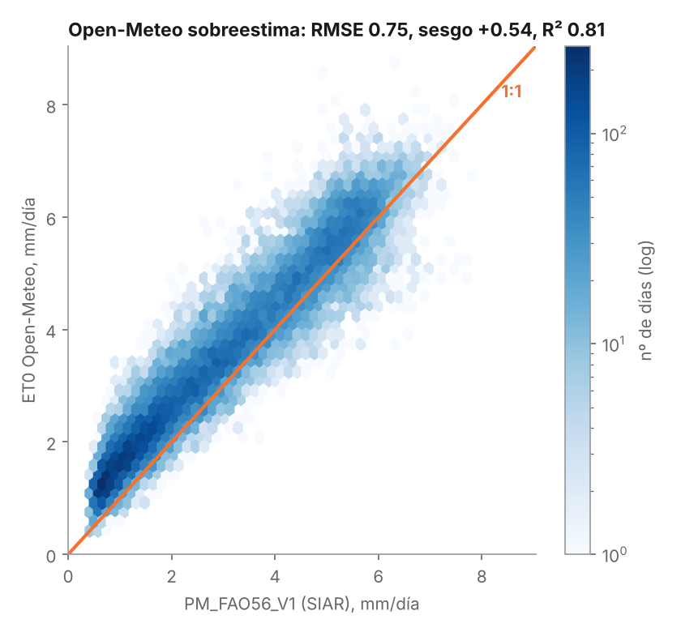
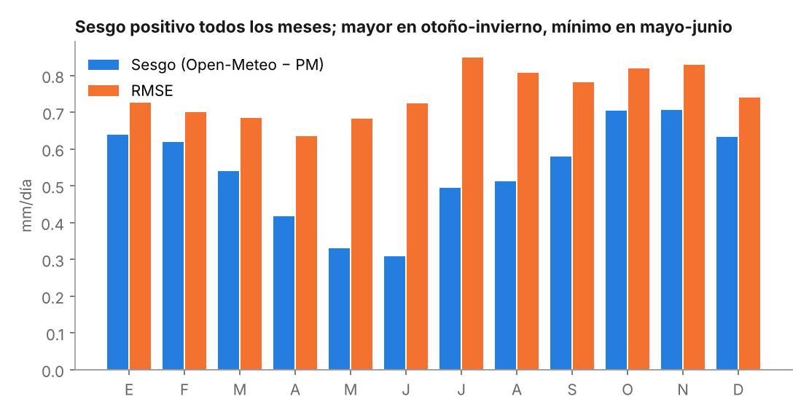
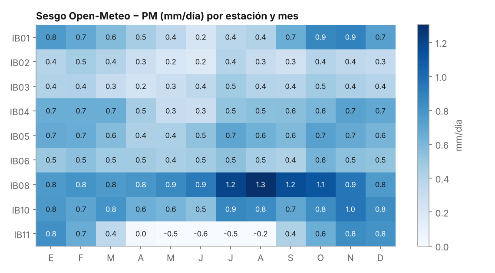
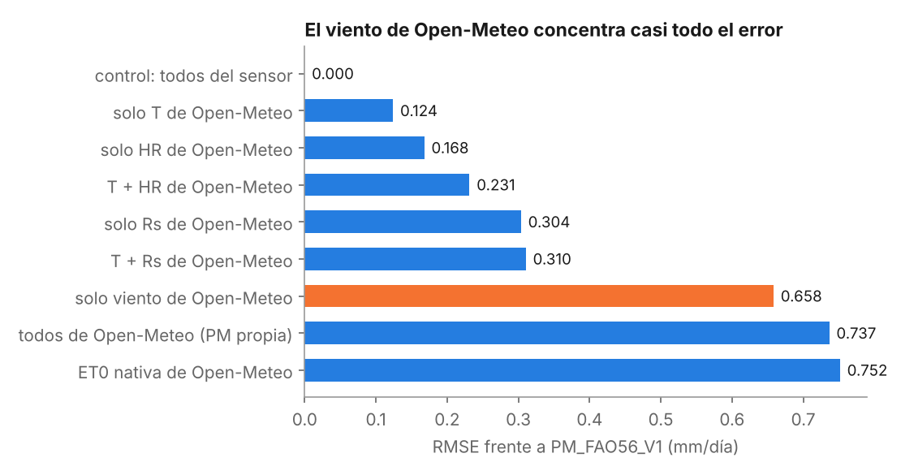

# Estudio 01 - ET0 de Open-Meteo frente a PM_FAO56_V1

**Pregunta.** La ET0 de Open-Meteo se parece a la PM calculada de SIAR mas de lo que se parecen las formulas V2 con pocos inputs? Responde si el producto es competitivo y, si no, que variable de rejilla falla.

**Pasos**
1. ET0 directa: `et0_fao_evapotranspiration` de Open-Meteo (`archive`) frente a `PM_FAO56_V1`, 9 estaciones activas, 2020-2025 (`compare.py`).
2. Diagnostico de inputs: `diagnose_inputs.py` (hecho, ver abajo).
3. Comparacion con modelos V2 (AHC, ML, ANN) sobre las mismas claves estacion-fecha (pendiente: exportar sus predicciones desde Capitulo-1).

**Criterio de exito**: `config/thresholds.json` (v1, fijado el 2026-11-25 antes de descargar nada).

**Ejecucion**
```
PYTHONPATH=src python studies/01_et0_vs_pm/compare.py \
    --reference data/reference/reference_2020_2025.csv \
    --openmeteo data/processed/openmeteo_archive.csv
```
Escribe en `results/openmeteo_archive/`: metricas global, por estacion, anio, mes, temporada y combinaciones (`openmeteo.csv`, y una por formula clasica), `summary.md` con veredicto y el SHA256 de las claves de la cohorte.

**Que no se concluye**: que Open-Meteo sea mejor o peor en general; solo su acuerdo con PM calculada en estas estaciones y fechas.

## Primer resultado (26/11/2026)

Datos: `archive` de Open-Meteo (reanalisis), 9 estaciones, 2020-2025; referencia `ET0_PM_FAO56_V1` de `classical-baselines.csv`
(SHA256 del original `f55e4ed1...af44`, subconjunto en `data/reference/`). Cohorte: 19.251 pares (coincide con el `PM n` de V2).
Sanity check: las formulas V2 sin ajustar dan RMSE 0,949 (HS-Ra) y 0,624 (Valiantzas), iguales a las publicadas.

| Metodo | RMSE (mm/dia) | Sesgo (mm/dia) |
|---|---:|---:|
| Open-Meteo `et0_fao_evapotranspiration` | 0,752 | +0,542 |
| HS-Ra sin ajustar | 0,949 | +0,578 |
| Valiantzas sin ajustar | 0,624 | +0,237 |
| HG-Rs sin ajustar | 0,567 | +0,294 |

Veredicto con `config/thresholds.json` v1: **UTILIZABLE_NO_DIFERENCIAL** (RMSE global entre 0,62 y 0,95; ademas IB08 supera 1,0 por estacion).
Con la ventana 2021-2025 el resultado es practicamente el mismo (RMSE 0,746, sesgo +0,541). La ventana de TEST no esta
definida de forma unica en la documentacion de Capitulo-1 (2020-2025 frente a 2021-2025), por eso se publican ambas.

Lectura: casi todo el error es sesgo sistematico (sobreestima en las 9 estaciones y en todos los meses). Con RMSE^2 = sesgo^2 + varianza,
el error sin ese sesgo seria de unos 0,52 mm/dia. Pendiente: comparacion con las predicciones de AHC, ML y ANN de V2.

Resultados completos: `results/archive_2020_2025/` y `results/archive_2021_2025/`.

## Diagnostico de inputs (26/11/2026)

`diagnose_inputs.py` compara los inputs de Open-Meteo con los del sensor y recalcula PM FAO-56 (`src/openmeteo_et0/pm.py`)
sustituyendo inputs de uno en uno. Control: con los 4 inputs del sensor, la PM propia reproduce `PM_FAO56_V1` con error maximo
de 3e-6 mm/dia (19.251 filas) y da 3,88 mm/dia en el ejemplo 18 de FAO-56. Viento de Open-Meteo convertido de 10 m a 2 m (x0,748);
SIAR se toma como 2 m (convencion de Capitulo-1, no verificada por estacion).

| Escenario (PM recalculada frente a PM_FAO56_V1) | RMSE | Sesgo |
|---|---:|---:|
| solo temperatura de Open-Meteo | 0,124 | -0,049 |
| solo humedad de Open-Meteo | 0,168 | -0,010 |
| solo radiacion de Open-Meteo | 0,304 | +0,147 |
| **solo viento de Open-Meteo** | **0,658** | **+0,509** |
| todos los inputs de Open-Meteo | 0,737 | +0,521 |
| ET0 nativa de Open-Meteo | 0,752 | +0,542 |

Lectura: el sesgo positivo viene casi entero del viento (media a 2 m: 2,60 m/s en Open-Meteo frente a 1,25 m/s en SIAR; correlacion 0,68).
Temperatura (Tmax -1,8 C, Tmin +3,2 C, rango diurno 5 C menor) y humedad pesan poco en ET0; la radiacion (+1,5 MJ/m2/dia) algo mas.
Cautela: la diferencia de viento mezcla el efecto rejilla (mar/tierra, rugosidad) con la altura efectiva del anemometro de cada estacion,
que no esta verificada. La ET0 nativa de Open-Meteo no es identica a la PM recalculada con sus inputs diarios (diferencia media -0,02,
RMSE 0,23, correlacion 0,992): su documentacion indica que se calcula por horas y se suma, sin detallar altura de viento ni variable de radiacion.

## Gráficos y tablas ampliadas





Tablas por estación, mes y año, comparación de inputs y escenarios de sustitución: `results/tablas_ampliadas.md` (se regeneran con `python studies/01_et0_vs_pm/make_figures.py`).

### Interpretación
- El sesgo es positivo en las 9 estaciones y los 12 meses y es el 52 % del error cuadrático: quitándole el sesgo medio global el RMSE baja de 0,752 a 0,521.
- El sesgo absoluto es mayor en otoño-invierno (+0,6–0,7 mm/día en oct–dic) y menor en mayo–junio (+0,3); en relación con la ET0 es enorme en invierno (+60 % en dic–ene) y pequeño en verano (+6–11 %).
- IB08 e IB10 son las peores (RMSE 1,04 y 0,91, sesgo +0,94 y +0,76) y IB11 tiene el menor sesgo (+0,23) pero un RMSE alto: el error de IB11 es sobre todo ruido, no desplazamiento.
- Entre los inputs, la temperatura de Open-Meteo tiene el rango diurno 5 °C más pequeño (Tmin +3,2 °C, Tmax −1,8 °C) y el viento a 2 m es el doble del medido (2,60 frente a 1,25 m/s). Cambiar solo el viento da casi todo el error (RMSE 0,658, sesgo +0,51); T, HR y Rs por separado dan 0,12, 0,17 y 0,30.
- Sustituir inputs de uno en uno no es aditivo: T+HR da 0,231 y no 0,124+0,168.
