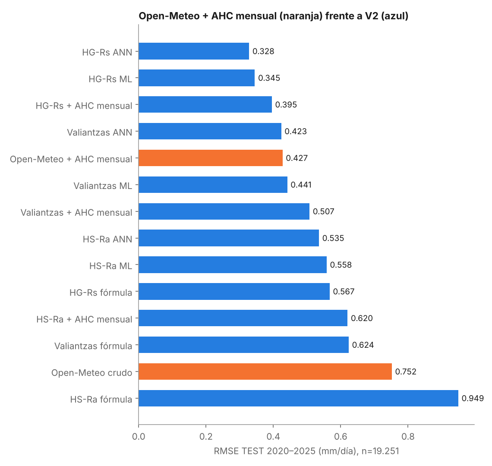
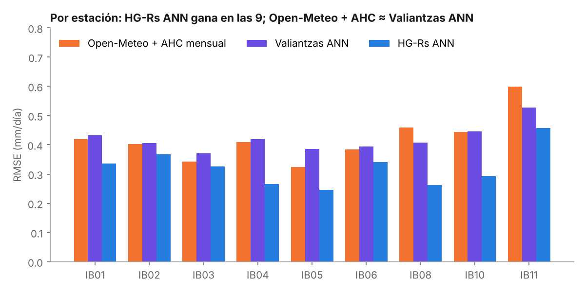
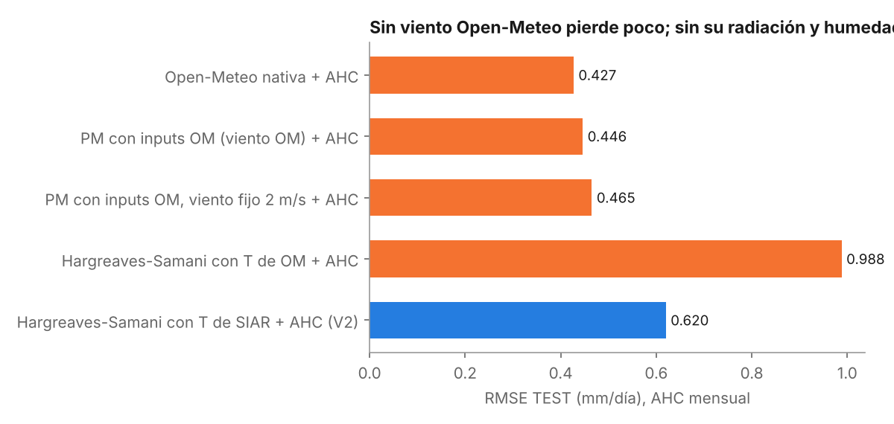
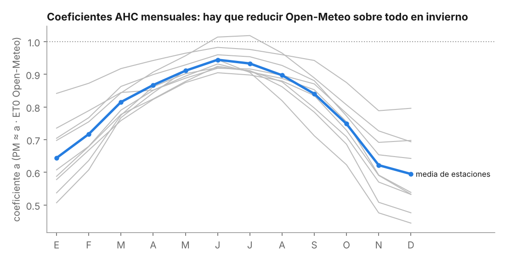

# Estudio 02: Open-Meteo + ajuste tipo AHC frente a V2

Criterios fijados antes de ejecutar: `config/thresholds_v2.json`. Ejecutar: `python studies/02_openmeteo_ahc/run.py`.

**Protocolo (igual que V2):** coeficiente `a = Σ(x·PM)/Σ(x²)` por estación y granularidad (anual, estacional, mensual), con x = ET0 de Open-Meteo (archive), ajustado solo con DESARROLLO (2004–2019, 48.445 pares) y evaluado en TEST 2020–2025 sobre la cohorte común de V2 (n=19.251, mismas claves). No se elige granularidad mirando TEST.

## Resultado global (RMSE mm/día, referencia PM_FAO56_V1)

| | Open-Meteo crudo | OM + AHC anual | OM + AHC estacional | OM + AHC mensual |
|---|---|---|---|---|
| RMSE | 0,752 | 0,534 | 0,454 | 0,427 |
| Sesgo | +0,542 | +0,103 | +0,016 | −0,005 |
| R² | 0,806 | 0,902 | 0,929 | 0,938 |

Tabla completa contra cada fórmula/AHC/ML/ANN de V2 y granularidad: `results/comparison.md`. Métricas globales y por estación: `results/metrics_*.csv`; coeficientes: `results/coefficients.csv`; predicciones: `results/predictions_openmeteo_2020_2025.csv`.

## Gráficos

Tablas completas (por método, estación, mes, año, coeficientes y variantes): `results/tablas_ampliadas.md`. Las figuras se regeneran con `python studies/02_openmeteo_ahc/make_figures.py`.

## Lectura
- **A (OM+AHC frente a fórmulas V2):** mejora a las tres fórmulas sin ajustar en las tres granularidades, y al AHC de HS-Ra en todas y al de Valiantzas en estacional y mensual. No mejora al AHC de HG-Rs (RMSE 0,395–0,413) ni, en anual, al AHC de Valiantzas (0,512).
- **B (ML/ANN frente a OM+AHC):** ML y ANN de HG-Rs ganan en todas las granularidades y en las 9 estaciones (ANN 0,328–0,368); en Valiantzas ganan en anual y estacional y quedan prácticamente empatados en mensual (0,423–0,441 frente a 0,427); los de HS-Ra (solo Tmin/Tmax/Ra) no superan a OM+AHC estacional ni mensual.
- **La diferencia depende de la época del año.** De octubre a febrero Open-Meteo + AHC mensual iguala a la ANN de Valiantzas (0,25–0,32) y se acerca a la de HG-Rs; de abril a septiembre se queda en 0,44–0,61 frente a 0,25–0,31 de la ANN de HG-Rs. Es justo la temporada de más demanda de riego, así que es la que más pesa en la práctica.
- **Open-Meteo sobreestima mucho más en invierno:** el coeficiente AHC medio pasa de ≈0,60 (dic–ene) a ≈0,95 (jun–jul). Un coeficiente anual único corrige mal esa forma, por eso la granularidad mensual mejora tanto (0,534 → 0,427).
- **Variantes más justas (`fair_variants.py`, mismo AHC):** con el viento de Open-Meteo sustituido por 2 m/s fijos la PM propia con AHC mensual da 0,465 frente a 0,446 con su viento: tras calibrar, el viento aporta poco (la calibración ya absorbe el sesgo). Hargreaves-Samani con las T de Open-Meteo (0,988) es mucho peor que con las T de SIAR (0,620): las T de la rejilla tienen un rango diurno 5 °C demasiado pequeño, lo que rompe la fórmula basada en Tmax−Tmin. Es decir, lo que sirve de Open-Meteo es su radiación y su humedad; sus temperaturas no son sustituto del sensor para modelos de pocos inputs.
- Mejor V2 (HG-Rs ANN) 0,328 frente a mejor OM+AHC 0,427.
- **Deriva:** el sesgo anual de OM+AHC es +0,06…+0,18 según el año (2024 el peor, +0,18 en anual y +0,05 en mensual). Los coeficientes de 2004–2019 se mantienen razonablemente en 2020–2025, sobre todo con ajuste mensual.

## Salvedades
Open-Meteo usa todas las entradas y las fórmulas V2 pocas; el coeficiente ajustado sobre reanálisis puede no transferirse a la previsión; el catálogo derivado V2 sigue en DRAFT; el filtrado de DESARROLLO (PM no vacío, `evaluated_PM`) es criterio propio; no hay intervalos de confianza (diferencias de ≈0,01 mm/día, como Valiantzas ANN frente a OM+AHC mensual, no son concluyentes); `fair_variants.py` solo cubre HS-Ra de forma exacta (reproduce V2 a 4e-6), no Valiantzas ni HG-Rs porque no se han reimplementado esas fórmulas.
