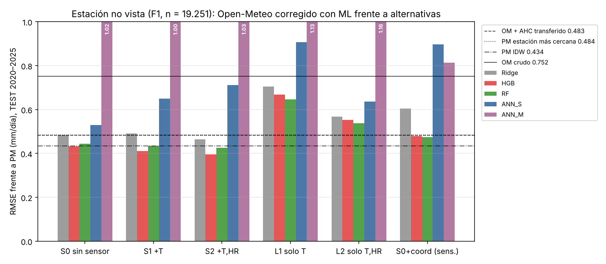
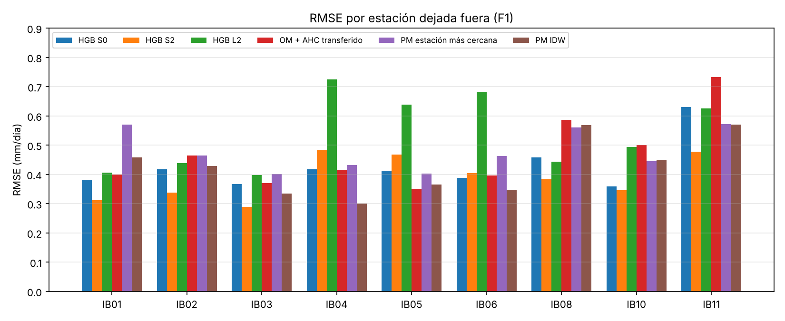
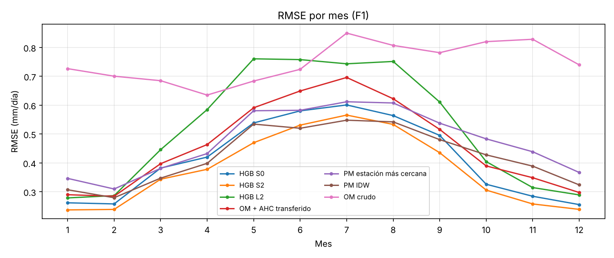
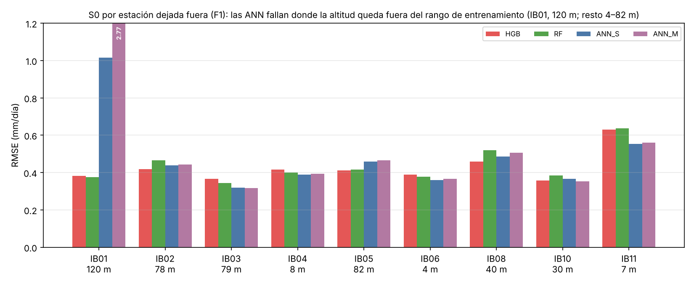

# Estudio 03: Open-Meteo corregido con ML, evaluado en estaciones no vistas (leave-one-station-out)

> **Numeración:** este estudio es el **03.2**. Se ejecuta después del **03.1** (`studies/03_1_loso_inputs_siar/`), que comprueba primero si los modelos de pocos inputs de SIAR funcionan en una estación no vista; el 03.1 es el que justifica (o no) este cambio de rumbo. La carpeta se llamaba `studies/03_loso_openmeteo_ml/` y se renombró a `studies/03_2_loso_openmeteo_ml/` tras la ejecución, para que siga la numeración de `03_1_…` y `03_1_2_…`. `config/thresholds_v3.json` **conserva su nombre** porque está congelado: su SHA256 consta en los manifiestos de resultados del 03.1 y del 03.2 y el código del 03.1 lo lee por esa ruta. Por la misma razón, los `_comment` de `thresholds_v3.json` y `thresholds_v3_1.json` (ficheros congelados) siguen citando la ruta antigua `studies/03_loso_openmeteo_ml/exploratorio/`, que hoy es `studies/03_2_loso_openmeteo_ml/exploratorio/`.

Estado: **PLAN**. Protocolo y criterios en `config/thresholds_v3.json`; se congelan al fusionar el PR que los introduce, antes de ejecutar nada de este protocolo.

> **Ejecución (2026-11-26/27): COMPLETA.** Las 360 celdas (12 particiones × 6 escenarios × Ridge, HGB, RF, ANN-S y ANN-M) y todos los comparadores. **H1–H4 se cumplen** (H1 y H3, «significativas pero pequeñas»); veredicto, interpretación y salvedades en las Partes II–VI. El plan (Parte I) no se ha tocado: `thresholds_v3.json` quedó congelado al fusionar el PR #8.

## Índice

- **Parte I — Plan congelado** (sin cambios desde el PR #8)
- **Parte II — Resultados**: ejecución, controles, tablas, hipótesis H1–H4, regla de decisión, secundario, RF y ANN
- **Parte III — Análisis exploratorio posterior (post hoc)**: qué significa frente a lo que ya existe (ranking con inputs y tipo de modelo), diagnóstico del fallo de las ANN, sensibilidad sin IB01
- **Parte IV — Conclusiones sobre los modelos**
- **Parte V — Propuestas de mejora y variantes con posibilidades**
- **Parte VI — Salvedades de la ejecución**

# Parte I — Plan congelado

## Por qué este estudio (cambio de rumbo)

Los estudios 01 y 02 dejan tres hechos:

1. Las ANN de V2 ganan a Open-Meteo + AHC **en su propia estación** (entrenadas y evaluadas en el mismo sitio). Es el caso de menos valor práctico: quien tiene una estación SIAR al lado ya tiene PM.
2. La familia que gana siempre (HG-Rs) necesita piranómetro. Quien tiene piranómetro suele tener también termohigrómetro y anemómetro, es decir, puede calcular PM. La familia realista con sensor barato (Valiantzas: T y HR) solo empata o gana por poco.
3. El error de Open-Meteo viene sobre todo del **viento** de la rejilla y de un **rango diurno de temperatura** demasiado estrecho; su radiación y su humedad son buenas (estudio 01, sustitución de inputs). Open-Meteo tiene la información, pero necesita corrección.

Una prueba exploratoria (`exploratorio/`, ver abajo) sugiere que un modelo **conjunto para Baleares** que corrige Open-Meteo con ML, entrenado con la PM de SIAR de otras estaciones, estima mejor en una estación no vista que copiar la estación más cercana o aplicar un coeficiente mensual. En cambio, los modelos que solo usan pocos inputs locales (T, o T y HR) se degradan mucho fuera de su estación.

Por eso se propone reorientar el producto de "ANN con pocos inputs locales" a **"datos de rejilla (Open-Meteo) corregidos para tu ubicación con la referencia SIAR"**, con sensor del usuario opcional. Este estudio lo comprueba con protocolo formal.

Pregunta principal: **en una ubicación sin estación SIAR, ¿un modelo conjunto que corrige Open-Meteo con ML se acerca a la PM de SIAR más que las alternativas sencillas?**

## Datos

| Bloque | Periodo | Fuente | Estado |
|---|---|---|---|
| Open-Meteo `archive` diario | 2004–2025 | `data/processed/openmeteo_archive.csv` | disponible |
| Referencia PM_FAO56_V1 | 2004–2025 | `data/reference/reference_*.csv` | disponible |
| Inputs de sensor SIAR | 2020–2025 | `data/reference/siar_inputs_2020_2025.csv` | disponible |
| Inputs de sensor SIAR | 2004–2019 | `data/reference/siar_inputs_2004_2019.csv` | **falta: paso previo** |
| Predicciones V2 (contexto) | 2020–2025 | `data/v2/` | disponible |

**Paso previo.** Exportar los inputs de sensor 2004–2019 con `tools/export_reference.py` desde `classical-baselines.csv` (SHA256 `f55e4ed1…af44`, en el servidor), con las mismas columnas que la exportación 2020–2025 (`--keep TempMax,TempMin,TempMedia,HumedadMax,HumedadMin,HumedadMedia,VelViento,Radiacion,quality_status --start 2004-01-01 --end 2019-12-31`). Si no se puede, alternativa: `datos_siar_baleares/IBxx_datos_completos.csv` de Capitulo-1, comprobando antes que en 2020–2025 coinciden con la exportación existente; si no coinciden, se para y se documenta.

## Diseño

**Separación espacial y temporal a la vez.** Se entrena solo con DESARROLLO (2004–2019) y solo con las estaciones de entrenamiento; se evalúa en TEST (2020–2025) en la estación dejada fuera, sobre la cohorte común de V2 (`common_core == 1`, n = 19.251), las mismas claves que el estudio 02. Así los números son comparables con V2 y con el estudio 02.

**Particiones (fijas, en `folds.json`):**
- **F1, leave-one-station-out (principal):** 9 particiones, una por estación.
- **F2, leave-one-island-out (prueba dura):** fuera Ibiza (IB01, IB11) y fuera Menorca (IB08). "Fuera Mallorca" deja solo 3 estaciones de entrenamiento: se ejecuta y se informa, pero no entra en los criterios.

**Escenarios de inputs** (lo que tendría un usuario en su parcela):

| Código | Inputs | Usuario tipo |
|---|---|---|
| S0 | Open-Meteo (ET0, Tmax, Tmin, radiación, viento medio y máximo, HR media/máx/mín) + seno y coseno del día del año + Ra + altitud | sin sensor |
| S1 | S0 + Tmax y Tmin del sensor | termómetro |
| S2 | S0 + Tmax, Tmin y HR media del sensor | termohigrómetro |
| L1 | solo sensor: Tmax, Tmin, Ra, día del año, altitud | modelo conjunto tipo HS-Ra |
| L2 | solo sensor: Tmax, Tmin, HR media, Ra, día del año, altitud | modelo conjunto tipo Valiantzas |

Latitud y longitud **no** entran en el escenario principal: con 9 estaciones funcionan casi como un identificador y el modelo memoriza. Se prueba solo como sensibilidad (S0+coord).

**Modelos (conjunto cerrado, declarado antes):**

| Modelo | Por qué |
|---|---|
| Ridge (lineal, inputs estandarizados) | Corrección estadística clásica (MOS); suelo de referencia |
| HistGradientBoosting | Primario (declarado de antemano) |
| Random Forest | Segundo árbol, distinto sesgo de modelo |
| ANN-S: MLP (32) | Red pequeña |
| ANN-M: MLP (64, 32) | Red media |

Hiperparámetros: rejilla pequeña declarada en `thresholds_v3.json`, elegida con validación cruzada interna agrupada por estación **dentro del entrenamiento** de cada partición. Nunca se mira TEST para elegir. Las ANN se entrenan con 5 semillas; la predicción es la media de las 5 y se informa además la dispersión entre semillas (incertidumbre de entrenamiento, que el estudio 02 no cubría). Predicciones negativas: se recortan a 0 y se informa cuántas.

No se añaden más arquitecturas después de ver resultados: comparar muchas variantes en el mismo TEST acaba eligiendo la que tuvo suerte.

**Comparadores:**

| Comparador | Qué representa |
|---|---|
| Open-Meteo crudo | lo que obtiene cualquiera gratis |
| OM + AHC mensual medio de las estaciones de entrenamiento | la corrección sencilla transferida |
| OM + AHC mensual de la estación de entrenamiento más cercana | idem, versión "vecino" |
| PM de la estación SIAR más cercana el mismo día | lo que hace la app SiAR |
| PM interpolada (IDW) de las estaciones de entrenamiento el mismo día | interpolación espacial sencilla |
| V2 local (HS-Ra, HG-Rs, Valiantzas: fórmula, AHC, ANN) y OM+AHC local del estudio 02 | **techo**: modelos de la propia estación; no son LOSO, solo contexto |

Los comparadores de estación más cercana e IDW usan observaciones del mismo día de otras estaciones: es legítimo como servicio operativo (esos datos existen en tiempo real), y se indica así.

## Métricas y criterios

Mismas definiciones que V2 y estudio 02: error = predicción − PM; n, MAE, RMSE, sesgo, R² = 1 − SSE/SST; DJF asigna diciembre al año siguiente. Desgloses por estación, mes, temporada y año. Diferencias pareadas ΔRMSE con IC 95 % por bootstrap de bloques estación-año (54 bloques, 2.000 réplicas, semilla fija).

Hipótesis (criterios en `config/thresholds_v3.json`):

- **H1 (principal):** HGB-S0 en F1 tiene menor RMSE que OM + AHC mensual medio transferido (ΔRMSE < 0 y extremo superior del IC < 0).
- **H2:** HGB-S0 en F1 tiene menor RMSE que la PM de la estación más cercana.
- **H3:** el sensor del usuario aporta: S2 mejora a S0 con el mismo modelo (IC < 0).
- **H4 (documenta el cambio de rumbo):** los modelos conjuntos solo de sensor (L1, L2) tienen mayor RMSE que S0.
- **Relevancia práctica:** una diferencia significativa menor de 0,05 mm/día se informa como "significativa pero pequeña".

Todo lo demás (otros modelos, F2, sensibilidad con coordenadas) se informa como secundario, sin veredicto.

## Salidas

`results/`: `folds.json`, `metrics_global.csv`, `metrics_by_station.csv`, `metrics_by_month.csv`, `paired_ci.csv`, `ann_seed_spread.csv`, `predictions_test.csv` (con columna de partición), `run_manifest.json` (SHA256 de entradas, versiones de librerías, semillas). `figures/` con RMSE por escenario y modelo, por estación y por mes. El README se completa con la lectura y las salvedades.

Dependencias: este estudio usa scikit-learn, pandas y numpy (`requirements.txt` de la carpeta). La librería `src/openmeteo_et0` sigue sin dependencias.

## Salvedades conocidas de antemano

- Referencia calculada (PM_FAO56_V1), no ET0 medida.
- Solo 9 estaciones, todas en zonas de regadío y cercanas entre sí: F1 es optimista; por eso F2.
- Se usa reanálisis (`archive`), que llega con unos 5 días de retraso. No dice nada del error con **previsión**: eso es el estudio 04.
- Open-Meteo: datos CC BY 4.0, API gratuita solo no comercial.

## Prueba exploratoria previa (no es resultado de este estudio)

`exploratorio/loso_rapido.py` y su salida `exploratorio/salida_2026-11-26.txt`: una sola ejecución con HGB, entrenamiento ≤ 2022 y prueba 2023–2025 (distinto de este protocolo), sin IC. Resultado: OM + ML sin sensor 0,41 mm/día de RMSE en estación no vista; OM + AHC mensual transferido 0,47; estación más cercana ≈ 0,47 (0,40–0,57 según el par); modelos conjuntos solo de sensor 0,57–0,69; Open-Meteo crudo 0,75. Se declara aquí porque el diseño de este estudio se escribió **después** de verla: es la razón del cambio de rumbo, no su demostración.

---

# Parte II — Resultados (ejecución del 2026-11-26/27)

## Estado de la ejecución

| Bloque | Celdas | Estado | Dónde |
|---|---|---|---|
| Comparadores (OM crudo, OM + AHC transferido y vecino, PM más cercana, IDW) y techo local | — | hecho | entorno de trabajo de Claude |
| Ridge | 72 | hecho | entorno de trabajo de Claude (~1 s/celda) |
| HGB (primario) | 72 | hecho | entorno de trabajo de Claude (~1 min/celda) |
| RF | 72 | hecho | Kaggle, sesiones 1 y 2 |
| ANN-S y ANN-M (5 semillas) | 144 | hecho | Kaggle, sesiones 3 y 4 |

**Total: 360/360 celdas**; `results/run_manifest.json` → `missing_cells` vacío. Celda = partición (9 F1 + 3 F2) × escenario (S0, S1, S2, L1, L2, S0_coord) × modelo. Cada celda se guarda en `results/cells/` (gzip, escritura atómica: se escribe en `.tmp` y se renombra) con sus predicciones (y las de cada semilla en las ANN), la rejilla de validación interna, el número de recortes a 0 y el entorno con el que se calculó.

```
python studies/03_2_loso_openmeteo_ml/run.py fit --models Ridge,HGB --workers 2   # ~35 min con 2 núcleos
bash   studies/03_2_loso_openmeteo_ml/kaggle_session.sh N                         # N = 1..4, en Kaggle (RF y ANN)
python studies/03_2_loso_openmeteo_ml/run.py report                              # ~25 s: tablas, IC, decision.json, figuras
python studies/03_2_loso_openmeteo_ml/diagnostico_ann_altitud.py                 # diagnóstico posterior de las ANN (sin veredicto)
```

**Kaggle (2026-11-27).** `kaggle_session.sh N` (CPU sin acelerador, internet activado, 4 núcleos, `--max-hours 8`), clonando esta rama:

```
!git clone -b estudio-03-2-ejecucion https://github.com/lependens/Capitulo-2.git
%cd Capitulo-2
!bash studies/03_2_loso_openmeteo_ml/kaggle_session.sh N
```

La cuenta admite 4 sesiones a la vez; el trabajo pesado se repartió en 4 sesiones paralelas sin solaparse (un test comprueba que cubren las 216 celdas exactamente una vez). Ninguna llegó al tope de 8 h, así que no hizo falta la sesión de continuación (`kaggle_session.sh 0`).

| Sesión | Contenido | Celdas | Estimación previa | Real |
|---|---|---|---|---|
| 1 | RF, F1 IB01–IB05 | 30 | ~3 h | 257 min |
| 2 | RF, F1 IB06, IB08, IB10, IB11 y las 3 particiones F2 | 42 | ~3,5 h | 266 min |
| 3 | ANN-S, todo | 72 | ~2–2,5 h | 258 min |
| 4 | ANN-M, todo | 72 | ~2,5–3 h | ~329 min |

La estimación (medida aquí con un núcleo y escalada a 4) se quedó corta en un factor de 1,2–2: probablemente porque Kaggle es más lento por núcleo y las celdas corren en paralelo (no se ha medido por separado). Cada sesión dejó `celdas_03_2_sesion_N.zip`, que se descomprimió en `results/cells/` antes de `report`.

## Paso previo

`data/reference/siar_inputs_2004_2019.csv` (y su manifiesto) se trae **sin cambios** del commit 76d4aa8 del 03.1, que lo generó con `tools/export_inputs_from_raw.py` a partir de `datos_siar_baleares/IBxx_datos_completos.csv` de Capitulo-1 (la alternativa prevista arriba): en 2020–2025 coincide con la exportación existente con 0 discrepancias (19.272 filas × 8 columnas). Es el mismo objeto git que en la rama del 03.1, así que las dos ramas pueden fusionarse sin conflicto.

## Código compartido con el 03.1

`loso_common.py` (carga de datos, particiones, comparadores, métricas, bootstrap) y `loso_models.py` (rejillas y `select_and_fit`) son **copia literal** de `studies/03_1_loso_inputs_siar/` (commit 76d4aa8; idénticos también a la punta b8e2896 de `estudio-03-1-ejecucion`). No se ha modificado nada. `run.py` los carga con nombres de módulo propios para que los tests de los dos estudios puedan convivir en el mismo proceso. SHA256 en `run_manifest.json`.

## Controles

- **Particiones idénticas al 03.1:** `results/folds.json` es byte a byte igual al del 03.1.
- **Comparadores idénticos al 03.1** (mismo código, mismas filas): OM crudo 0,752; OM + AHC transferido 0,483; PM de la estación más cercana 0,484 (384 sustituciones por falta de dato, igual que en el 03.1); IDW 0,434.
- **L1 y L2 reproducen el 03.1:** L1 tiene los mismos inputs que la variante secundaria de HS-Ra del 03.1 y L2 que la de Valiantzas (en otro orden). HGB da 0,668 y 0,553, los mismos valores que allí.
- **Techo local:** V2 en la cohorte da los RMSE publicados (ANN E anual: 0,533 / 0,421 / 0,368) y OM + AHC local del estudio 02 da 0,534 (anual) y 0,427 (mensual).
- **Separación:** los tests comprueban, en cada partición, que ninguna estación de prueba entra en el entrenamiento, que se entrena solo con 2004–2019 y que las 9 particiones F1 cubren exactamente la cohorte (n = 19.251).

## Decisiones de implementación (no fijadas en los criterios)

1. **Inputs de Open-Meteo de S0** (`openmeteo_archive.csv`): `et0_om_mm`, `tmax_c`, `tmin_c`, `shortwave_sum_mj_m2`, `wind10_mean_ms`, `wind10_max_ms`, `rh_mean_pct`, `rh_max_pct`, `rh_min_pct`; más seno y coseno del día del año (periodo 365,25), Ra (FAO-56 con la latitud de la estación) y altitud de la estación (`stations.csv`). 13 inputs.
2. **Sensor:** S1 añade `TempMax` y `TempMin` de SIAR; S2 además `HumedadMedia`. L1 = `TempMax`, `TempMin` + calendario + Ra + altitud; L2 añade `HumedadMedia`. S0_coord = S0 + latitud y longitud.
3. **Objetivo:** PM_FAO56_V1 finita y ≥ 0 (regla de V2, como el 03.1).
4. **Filas de entrenamiento:** DESARROLLO, objetivo válido, estaciones de entrenamiento y todos los inputs del escenario finitos. Por eso el número de filas varía en 1 entre escenarios (42.958 en S0 frente a 42.957 en S2 en la partición IB01; `n_train` por celda en `model_selection.csv`).
5. **Validación interna:** dejar una estación fuera dentro de las de entrenamiento; métrica: media simple del RMSE de cada estación retenida; empate: la primera configuración de la rejilla (código del 03.1).
6. **Comparadores** (código del 03.1): AHC mensual = OLS por el origen; transferido = media simple de los coeficientes de las estaciones de entrenamiento; vecino = la de entrenamiento más cercana (haversine). PM de la estación más cercana con dato ese día (si falta, la siguiente). IDW con potencia 2.
7. **Techo local** (solo contexto, sin veredicto): V2 en las tres resoluciones y OM + AHC local del estudio 02 (`predictions_openmeteo_2020_2025.csv`).
8. **Bootstrap:** 54 bloques estación-año en F1 (en F2, los de esas estaciones), 2.000 réplicas, semilla 20261126, los mismos remuestreos para todas las comparaciones, IC por percentiles.

## Resultados F1 (estación no vista), TEST 2020–2025, n = 19.251

RMSE en mm/día. Tabla completa en `results/metrics_global.csv`.

| Método | RMSE | MAE | Sesgo | R² |
|---|---|---|---|---|
| Open-Meteo crudo | 0,752 | 0,626 | +0,542 | 0,806 |
| OM + AHC mensual transferido | 0,483 | 0,350 | −0,002 | 0,920 |
| OM + AHC mensual de la estación más cercana | 0,507 | 0,377 | +0,027 | 0,912 |
| PM de la estación más cercana, mismo día | 0,484 | 0,363 | +0,038 | 0,920 |
| **PM IDW de las 8 estaciones de entrenamiento, mismo día** (interpolación por inverso de la distancia²) | **0,434** | 0,324 | +0,047 | 0,935 |
| **HGB S0 (sin sensor)** | **0,433** | 0,315 | +0,042 | 0,936 |
| HGB S1 (+ termómetro) | 0,411 | 0,302 | +0,096 | 0,942 |
| **HGB S2 (+ termohigrómetro)** | **0,396** | 0,292 | +0,087 | 0,946 |
| HGB L1 (solo sensor T) | 0,668 | 0,496 | +0,219 | 0,847 |
| HGB L2 (solo sensor T y HR) | 0,553 | 0,399 | +0,157 | 0,895 |
| HGB S0 + coordenadas (sensibilidad) | 0,479 | 0,355 | +0,046 | 0,921 |
| *Techo local (no LOSO): OM + AHC mensual local (estudio 02)* | *0,427* | *0,309* | *−0,005* | *0,937* |
| *Techo local (no LOSO): V2 ANN E anual HS-Ra (T)* | *0,533* | *0,385* | *+0,144* | *0,903* |
| *Techo local (no LOSO): V2 ANN E anual Valiantzas (T, HR)* | *0,421* | *0,294* | *+0,088* | *0,939* |
| *Techo local (no LOSO): V2 ANN E anual HG-Rs (T, Rs)* | *0,368* | *0,284* | *+0,039* | *0,954* |

«Techo local» = método calibrado **con la propia estación** que se evalúa (necesita su histórico de PM); no es aplicable donde no hay estación y va sin veredicto. Ranking de todas las filas con los inputs que necesita cada una: Parte III.

**RMSE F1 por escenario y modelo** (ANN = ensemble de 5 semillas; sesgo entre paréntesis):

| Escenario | Ridge | **HGB** | RF | ANN-S | ANN-M |
|---|---|---|---|---|---|
| S0 sin sensor | 0,484 (+0,06) | **0,433** (+0,04) | 0,444 (+0,03) | 0,528 (−0,08) | 1,020 (−0,25) |
| S1 + termómetro | 0,491 (+0,11) | **0,411** (+0,10) | 0,434 (+0,06) | 0,649 (−0,11) | 1,002 (−0,21) |
| S2 + termohigrómetro | 0,465 (+0,07) | **0,396** (+0,09) | 0,426 (+0,04) | 0,712 (−0,17) | 1,031 (−0,26) |
| L1 solo sensor T | 0,704 (+0,20) | 0,668 (+0,22) | **0,646** (+0,18) | 0,906 (−0,08) | 1,128 (−0,15) |
| L2 solo sensor T, HR | 0,568 (+0,11) | 0,553 (+0,16) | **0,538** (+0,11) | 0,636 (−0,04) | 1,159 (−0,23) |
| S0 + coordenadas | 0,604 (+0,05) | 0,479 (+0,05) | **0,474** (+0,03) | 0,897 (−0,09) | 0,813 (+0,11) |

Las cifras globales de las ANN están dominadas por **una sola estación (IB01)**; ver «RF y ANN» más abajo.



## Hipótesis (ΔRMSE = A − B, F1, IC 95 %)

| Hipótesis | A | B | RMSE A | RMSE B | ΔRMSE [IC 95 %] | Criterio (`thresholds_v3.json`) | Veredicto |
|---|---|---|---|---|---|---|---|
| **H1 (principal)** | HGB-S0 | OM + AHC mensual transferido | 0,433 | 0,483 | −0,050 [−0,069; −0,029] | Δ < 0 y extremo superior < 0 | **Se cumple** (significativa pero pequeña: \|Δ\| = 0,0498 < 0,05) |
| **H2** | HGB-S0 | PM estación más cercana | 0,433 | 0,484 | −0,051 [−0,084; −0,018] | Δ < 0 y extremo superior < 0 | **Se cumple** (\|Δ\| = 0,051, justo por encima del umbral práctico) |
| **H3** | HGB-S2 | HGB-S0 | 0,396 | 0,433 | −0,037 [−0,062; −0,012] | extremo superior < 0 | **Se cumple** (significativa pero pequeña) |
| **H4** | HGB-L1 | HGB-S0 | 0,668 | 0,433 | +0,235 [+0,199; +0,274] | extremo inferior > 0 | sí |
|  | HGB-L2 | HGB-S0 | 0,553 | 0,433 | +0,120 [+0,079; +0,162] | extremo inferior > 0 | sí → **H4 se cumple** |

## Regla de decisión (aplicación literal)

`thresholds_v3.json` no define una regla de decisión aparte de las hipótesis: la regla es el criterio de cada hipótesis (solo F1, solo HGB) más el umbral práctico de 0,05 mm/día («una diferencia significativa menor de 0,05 se informa como significativa pero pequeña»). Todo lo demás es secundario y sin veredicto. Aplicada tal cual (`results/decision.json`):

- **H1 se cumple:** en una estación no vista, Open-Meteo corregido con HGB y sin sensor tiene menor error que Open-Meteo con el coeficiente mensual transferido. La mejora es de 0,050 mm/día (−10 %), **significativa pero pequeña**: queda 0,0002 por debajo del umbral.
- **H2 se cumple:** también gana a copiar la PM de la estación SIAR más cercana (−0,051, −11 %). Supera el umbral práctico por muy poco.
- **H3 se cumple:** un termohigrómetro del usuario mejora el modelo (−0,037, −9 %), **significativa pero pequeña**.
- **H4 se cumple:** los modelos conjuntos solo de sensor son claramente peores que S0 (+0,24 con termómetro y +0,12 con termohigrómetro). Documenta el cambio de rumbo: para una estación no vista, Open-Meteo corregido supera a los modelos de pocos inputs locales.

**Lectura:** el cambio de rumbo se sostiene, con ganancias modestas. Hay una salvedad importante que no entra en las hipótesis: **la IDW del mismo día empata con HGB-S0** (−0,002 [−0,030; +0,026]); solo S2 la supera, y por poco (−0,039 [−0,074; −0,003]). Es decir, sin sensor el modelo iguala, pero no mejora, la interpolación de las estaciones SIAR del mismo día. Su ventaja práctica es que no necesita esas estaciones (vale fuera de su red y con previsión, estudio 04). Además, HGB-S0 en estación no vista empata con OM + AHC mensual **local** del estudio 02 (+0,006 [−0,009; +0,020]), que sí usa datos de la propia estación.

Cifras ajustadas: H1 queda a 0,0002 del umbral práctico y H2 a 0,001. Se informan tal cual salen de la regla.

**Al completar RF y ANN el veredicto no cambia** (`decision.json` regenerado con las 360 celdas: los mismos valores). Ni RF ni ninguna ANN supera a HGB en el conjunto de F1, así que HGB sigue siendo la elección razonable además de la prefijada.

## Secundario (sin veredicto)

- **Por estación** (F1, `metrics_by_station.csv`, figura 2): HGB-S0 va de 0,36 (IB10) a 0,63 (IB11). Tiene menor RMSE que OM + AHC transferido en 7 de 9 estaciones; prácticamente igual en IB04 (0,417 frente a 0,416) y peor en IB05 (0,412 frente a 0,351). En IB04, IB05 e IB06 (Mallorca central) la IDW es la mejor opción (las estaciones vecinas están cerca). El sensor (S2) mejora en 6 de 9 estaciones, pero empeora en IB04, IB05 e IB06.
- **Por temporada** (`metrics_by_month.csv`): HGB-S0 / S2 / OM + AHC / estación más cercana / IDW: invierno 0,26 / 0,24 / 0,29 / 0,34 / 0,31; verano 0,58 / 0,54 / 0,66 / 0,60 / 0,54.
- **F2 (fuera de isla), HGB-S0 frente a OM + AHC / estación más cercana / IDW:** fuera Ibiza (12 bloques): 0,509 frente a 0,587 / 0,745 / 0,612, gana a los tres (IC < 0). Fuera Menorca (6 bloques): 0,458 frente a 0,587 / 0,561 / 0,568, gana a los tres. Fuera Mallorca (informativo, 3 estaciones de entrenamiento): 0,477, peor que OM + AHC (0,428). Al alejarse de la red SIAR, el modelo mantiene el error y los comparadores de vecindad empeoran.
- **Coordenadas (S0_coord):** empeoran (+0,046 [+0,025; +0,067]), como se temía en el diseño (memorizan la estación).
- **Ridge:** peor que HGB en todos los escenarios (S0: +0,051 [+0,032; +0,070]); en S0 empata con OM + AHC transferido. 489 predicciones de Ridge recortadas a 0 en total; HGB, 0.
- **Comparadores entre sí:** IDW gana a la estación más cercana (−0,049 [−0,069; −0,032]); OM + AHC transferido empata con ella (−0,001 [−0,038; +0,035]); el AHC del vecino es peor que el transferido (+0,024 [+0,012; +0,037]).
- **Hiperparámetros elegidos** (`model_selection.csv`): en S0, HGB elige tasa 0,1 y 31 hojas en 8 de 9 particiones.





## RF y ANN (secundario, sin veredicto)

No intervienen en H1–H4. Comparaciones emparejadas completas en `results/paired_ci.csv` (`kind = modelo_vs_HGB` y `vs_comparador`).

**Random Forest.** Sigue el mismo patrón que HGB con algo más de error cuando hay inputs de Open-Meteo: ΔRMSE RF − HGB en S0 +0,011 [+0,002; +0,020], S1 +0,023 [+0,004; +0,043] y S2 +0,030 [+0,009; +0,050] (las tres «significativas pero pequeñas»). En los modelos solo de sensor es algo mejor: L1 −0,023 [−0,041; −0,005]. RF-S0 gana a OM + AHC transferido (−0,039 [−0,053; −0,022]) y a la estación más cercana (−0,040 [−0,072; −0,008]) y empata con la IDW (+0,010 [−0,015; +0,033]). Es decir, **las conclusiones de H1–H4 se sostienen con cualquiera de los dos modelos de árboles**. RF no recorta ninguna predicción a 0 y elige `min_samples_leaf = 5` en las 9 particiones.

**ANN-S y ANN-M: fallan por extrapolación de la altitud en IB01.** En el conjunto de F1 las dos ANN son peores que HGB en todos los escenarios, y ANN-M (~1,0 mm/día) llega a ser peor que Open-Meteo crudo. Pero el fallo está en una sola estación:

| RMSE S0 por estación dejada fuera | IB01 | IB02 | IB03 | IB04 | IB05 | IB06 | IB08 | IB10 | IB11 |
|---|---|---|---|---|---|---|---|---|---|
| Altitud (m) | **120** | 78 | 79 | 8 | 82 | 4 | 40 | 30 | 7 |
| HGB | 0,38 | 0,42 | 0,37 | 0,42 | 0,41 | 0,39 | 0,46 | 0,36 | 0,63 |
| RF | 0,38 | 0,47 | 0,34 | 0,40 | 0,42 | 0,38 | 0,52 | 0,39 | 0,64 |
| ANN-S | **1,02** | 0,44 | 0,32 | 0,39 | 0,46 | 0,36 | 0,49 | 0,37 | 0,55 |
| ANN-M | **2,77** | 0,44 | 0,32 | 0,39 | 0,47 | 0,37 | 0,51 | 0,35 | 0,56 |

Causa: **extrapolación de la altitud** (IB01 está a 120 m; las de entrenamiento, a 4–82 m). Diagnóstico completo en la Parte III.

**F2 (fuera de isla).** Fuera Ibiza (incluye IB01) las ANN fallan por lo mismo (S0: ANN-S 1,11, ANN-M 2,01, frente a HGB 0,51). Fuera Menorca, ANN-S (0,487) y ANN-M (0,506) ganan a los tres comparadores, como HGB (0,458) y RF (0,519). Fuera Mallorca (informativo, 3 estaciones de entrenamiento): RF 0,440 empata con OM + AHC transferido (0,428; +0,012 [−0,024; +0,047]) y es el mejor de los ML; HGB 0,477 y las ANN 0,52–0,53.

**Hiperparámetros de las ANN** (`model_selection.csv`, F1-S0): ANN-S elige α = 10⁻⁴ en 5 de 9 particiones y ANN-M en 8 de 9. No hay avisos de convergencia en ninguna de las 360 celdas.

# Parte III — Análisis exploratorio posterior (post hoc)

Todo lo de esta parte se calculó **después** de ver los resultados. Es exploratorio y no tiene veredicto: no cambia H1–H4 ni la regla de decisión de la Parte II. Las comparaciones con IC usan el mismo bootstrap (bloques estación-año, 2.000 réplicas, semilla 20261126).

## 1. Qué significa frente a lo que ya existe

### Qué es cada comparador de Open-Meteo + AHC

AHC = coeficiente de ajuste mensual: 12 factores (uno por mes) que multiplican la ET0 de Open-Meteo para acercarla a la PM de SIAR (regresión por el origen, PM ≈ k_mes × ET0_OM, ajustada con 2004–2019).

- **Transferido** (comparador de H1): los 12 coeficientes son la **media de las 8 estaciones de entrenamiento**. No usa nada de la estación evaluada. Es la forma sencilla de «corregir Open-Meteo donde no hay estación».
- **De la estación más cercana:** los coeficientes de la estación de entrenamiento más próxima (sale peor: 0,507).
- **Local (techo, estudio 02):** los coeficientes ajustados con **la propia estación** evaluada. Exige tener una estación con histórico de PM en ese punto.

### Lo que ve el modelo HGB-S0 de la estación evaluada

Nada de su PM ni de sus sensores. Se entrena con las otras 8 estaciones (2004–2019) y, de la estación evaluada, solo recibe como entrada su Open-Meteo diario, su altitud, su Ra y la fecha: información que existe en cualquier punto del mapa. Los tests comprueban en cada partición que la estación de prueba no entra en el entrenamiento.

### Comparación con los techos locales (`paired_ci.csv`, `kind = vs_techo_*`)

| Modelo LOSO (estación no vista) | vs OM + AHC local (0,427) | vs V2 ANN E HS-Ra local (0,533) | vs V2 ANN E Valiantzas local (0,421) | vs V2 ANN E HG-Rs local (0,368) |
|---|---|---|---|---|
| HGB-S0, sin sensor (0,433) | +0,006 [−0,009; +0,020] **empate** | −0,100 [−0,125; −0,073] **gana** | +0,012 [−0,011; +0,039] **empate** | +0,065 [+0,043; +0,088] pierde |
| HGB-S1, + termómetro (0,411) | −0,016 [−0,041; +0,011] **empate** | −0,122 [−0,149; −0,096] **gana** | −0,010 [−0,034; +0,014] **empate** | +0,043 [+0,020; +0,067] pierde (pequeña) |
| HGB-S2, + termohigrómetro (0,396) | −0,031 [−0,059; −0,002] **gana** (pequeña) | −0,137 [−0,164; −0,109] **gana** | −0,025 [−0,052; +0,001] **empate** (por muy poco) | +0,028 [+0,003; +0,054] pierde (pequeña) |

Lectura:

1. **Sin sensor y sin haber visto la estación, HGB-S0 empata con dos métodos calibrados en ella**: Open-Meteo + AHC local y la ANN local de V2 con termohigrómetro (Valiantzas). Y gana con claridad a la ANN local con solo termómetro (HS-Ra).
2. **Con termohigrómetro (S2) gana a Open-Meteo + AHC local** (pequeña) y queda prácticamente empatado con la mejor ANN local con termohigrómetro: el IC llega a +0,001.
3. **Solo la ANN local con piranómetro (HG-Rs) sigue por delante**, por 0,03–0,07. La radiación medida es el input más informativo y no la tenemos.
4. Parte de la ventaja frente a las ANN locales de V2 viene de que **Open-Meteo aporta viento y radiación** (modelizados), que HS-Ra y Valiantzas no tienen. No es solo mérito del ML.

### ¿Es ventajista usar T y HR de la estación evaluada?

No es una fuga de información: T y HR son **entradas**, no el objetivo, y un usuario con un termohigrómetro las tendría. El modelo sigue sin ver la PM de esa estación. Dos matices honestos:

- La PM de referencia se calcula con T, HR, viento y radiación de la estación, así que es esperable que medir T y HR ayude.
- Aquí T y HR vienen de **sensores SIAR calibrados**. Un sensor de usuario será peor, así que S1 y S2 son un **límite superior** de lo que obtendría.

Además, la mejora del sensor es pequeña (S2 − S0: −0,037) y **no es uniforme**: en Mallorca central (IB04, IB05, IB06) S2 empeora respecto a S0.

### Ranking: de peor a mejor (F1, RMSE en mm/día)

| # | Método | RMSE | Qué necesita el usuario | Tipo de modelo | ¿Sirve donde no hay estación SIAR? |
|---|---|---|---|---|---|
| 1 | Open-Meteo crudo | 0,752 | Nada (API gratuita) | Reanálisis meteorológico, sin corregir | Sí |
| 2 | HGB L1 (solo sensor T) | 0,668 | Termómetro (Tmax, Tmin) | ML conjunto (árboles), entrenado con 8 estaciones SIAR | Sí |
| 3 | HGB L2 (solo sensor T y HR) | 0,553 | Termohigrómetro | ML conjunto (árboles) | Sí |
| 4 | *V2 ANN E anual HS-Ra (techo)* | *0,533* | *Termómetro + histórico de PM de su propia estación* | *Red neuronal local, una por estación* | *No* |
| 5 | OM + AHC mensual de la estación más cercana | 0,507 | Nada (Open-Meteo + 12 coeficientes de la estación SIAR vecina) | Corrección empírica mensual | Sí |
| 6 | PM de la estación más cercana, mismo día | 0,484 | Nada (dato SIAR publicado de 1 estación) | Copia del vecino | Sí, si hay red cerca y publica a tiempo |
| 7 | OM + AHC mensual transferido | 0,483 | Nada (Open-Meteo + 12 coeficientes medios de la red) | Corrección empírica mensual | Sí |
| 8 | HGB S0 + coordenadas | 0,479 | Nada (Open-Meteo + ubicación) | ML conjunto (árboles) | Sí |
| 9 | PM IDW, mismo día | 0,434 | Nada (dato SIAR del día de 8 estaciones) | Interpolación espacial (inverso de la distancia²) | Sí, si hay red cerca y publica a tiempo |
| 10 | **HGB S0 (sin sensor)** | **0,433** | **Nada (Open-Meteo + altitud + fecha)** | **ML conjunto (árboles) que corrige Open-Meteo** | **Sí** (también con previsión, estudio 04) |
| 11 | *OM + AHC mensual local (techo, estudio 02)* | *0,427* | *Histórico de PM de su propia estación* | *Corrección empírica mensual local* | *No* |
| 12 | *V2 ANN E anual Valiantzas (techo)* | *0,421* | *Termohigrómetro + histórico de PM propio* | *Red neuronal local* | *No* |
| 13 | HGB S1 (+ termómetro) | 0,411 | Termómetro | ML conjunto que corrige Open-Meteo | Sí |
| 14 | **HGB S2 (+ termohigrómetro)** | **0,396** | **Termohigrómetro** | **ML conjunto que corrige Open-Meteo** | **Sí** |
| 15 | *V2 ANN E anual HG-Rs (techo)* | *0,368* | *Termómetro + piranómetro + histórico de PM propio* | *Red neuronal local* | *No* |

En cursiva, los techos locales (no aplicables donde no hay estación). Filas contiguas con RMSE muy parecido suelen estar **empatadas** (IC incluye 0). Por ejemplo: 6 y 7; 9, 10 y 11; 11, 12 y 13. No se lee el puesto como una victoria si la diferencia es de centésimas.

**Resumen de lo aprovechable:** sin estación y sin sensor, HGB-S0 baja un 42 % el error de Open-Meteo crudo, un 10 % el de las correcciones sencillas que se usan hoy, e iguala a calibrar Open-Meteo con una estación propia. Con un termohigrómetro (S2) es **el mejor método aplicable donde no hay estación**, y solo lo supera un modelo local con piranómetro.

### Sobre las ANN «sin IB01»

No son «aún mejores». Sin IB01, en S0–S2 las ANN **empatan** con HGB (ANN-M S2 0,391 frente a HGB 0,405: −0,015 [−0,035; +0,007]). Solo ganan, por ~0,05, en L1 y L2, que son los peores escenarios. Además, quitar IB01 es una decisión posterior a ver los resultados. Y en un servicio real **siempre habrá usuarios fuera del rango de entrenamiento**, que es justo donde las ANN fallan. Ver el punto 2.

## 2. Diagnóstico del fallo de las ANN: extrapolación de inputs estáticos



Script `diagnostico_ann_altitud.py` (posterior a la ejecución; no cambia nada del protocolo):

1. **IB01 es la única estación con un input fuera del rango de entrenamiento en todos sus días:** su altitud (120 m) supera la de las 8 estaciones de entrenamiento (4–82 m). Todos los inputs de Open-Meteo de IB01 caen dentro del rango visto (`diagnostico_rango_inputs_estaticos.csv`).
2. **El error es un desplazamiento constante, no ruido:** ANN-M en IB01 tiene sesgo −2,52 mm/día, de magnitud parecida todos los años 2020–2025 (RMSE anual 2,6–2,8). Así, 7.184 de sus 7.185 recortes a 0 en F1 son de IB01. Una red con activación ReLU extrapola linealmente fuera del rango; los árboles (HGB, RF) dan el valor del extremo visto (82 m) y no sufren.
3. **El mismo fallo aparece donde otro input estático sale de rango:** en S0 + coordenadas, IB08 (la más al norte y al este) e IB11 (la más al sur y al oeste) quedan fuera del rango de latitud y longitud, y ahí las ANN suben a 0,9–1,9 mm/día mientras HGB y RF se quedan en 0,62–0,66. IB06 está 3 m por debajo del mínimo de altitud y no se nota.
4. **Sin IB01 las ANN son tan buenas como HGB o mejores** (`diagnostico_sin_IB01.csv`, 8 estaciones, n = 17.059): en S0–S2 empatan (ANN-M − HGB en S2: −0,015 [−0,035; +0,007]) y en los modelos solo de sensor ganan (L2: ANN-M −0,051 [−0,072; −0,030]; L1: ANN-S −0,050 [−0,075; −0,026]). También recuperan el orden esperado: con sensor mejoran (ANN-S: S0 0,428 → S2 0,395), mientras que en el global parecía lo contrario.
5. **La inestabilidad entre semillas también es de IB01:** en S0, el RMSE de cada semilla de ANN-S va de 0,44 a 0,98 con IB01 y de 0,432 a 0,436 sin ella (DT 0,001). Sin IB01, la DT entre semillas es ≤ 0,012 mm/día en todos los escenarios salvo S0 + coordenadas (`diagnostico_semillas_ann.csv`). Cuál de las semillas extrapola peor en IB01 es casi aleatorio (ANN-S S0: sesgos de −2,4 a +1,0 según semilla).

Las dos pistas alternativas del traspaso (la parada temprana de `MLPRegressor` valida con un 10 % aleatorio, no agrupado por estación, y el objetivo no se escala) **no explican el fallo**: con ese mismo entrenamiento las ANN van bien en las 8 estaciones dentro de rango. El código de las ANN es copia literal y congelada del 03.1, así que no se ha corregido nada; se informa tal cual. Esto **confirma la explicación que el 03.1 dejó como «posible, no comprobada»** para su variante secundaria con altitud: allí las ANN también subían a 0,5–1,25 mm/día con sesgo negativo y gran dispersión entre semillas.

## 3. Sensibilidad de H1–H3 sin IB01

Sin IB01 (la estación que hace fallar a las ANN; `results/diagnostico_sin_IB01.csv`, mismo bootstrap): H1 −0,053 [−0,073; −0,032]; H2 −0,032 [−0,063; −0,001]; H3 −0,034 [−0,060; −0,007]. Las tres siguen cumpliendo su criterio, pero H2 pasa a «significativa pero pequeña» y su IC roza 0: buena parte de la ventaja sobre la estación más cercana viene de IB01 (Ibiza): su estación más cercana es IB11 (Formentera, a 32 km), cuya PM tiene allí un RMSE de 0,571 y un sesgo de +0,27, frente a 0,382 de HGB-S0.

# Parte IV — Conclusiones sobre los modelos

Esta parte valora los modelos en sí mismos. La regla de decisión ya está aplicada en la Parte II y no cambia.

## Lo bueno

1. **Sin sensor y sin estación, iguala a calibrar con una estación propia.** HGB-S0 (0,433) empata con Open-Meteo + AHC mensual local (0,427) y con la ANN local de V2 con termohigrómetro (0,421). Respecto a Open-Meteo crudo baja el error un 42 % y quita casi todo el sesgo (de +0,54 a +0,04 mm/día).
2. **Gana a las alternativas operativas sencillas** (H1 y H2: −10 %). Y donde más importa, lejos de la red, **gana con margen**: fuera Ibiza y fuera Menorca (F2) supera a los tres comparadores, mientras los métodos de vecindad empeoran (la estación más cercana sube a 0,75 fuera Ibiza).
3. **Con termohigrómetro (S2) es el mejor método aplicable donde no hay estación.** 0,396 gana a la IDW (−0,039 [−0,074; −0,003]) y a Open-Meteo + AHC local (−0,031). Solo un modelo local con piranómetro (0,368) lo supera.
4. **Calidad más pareja entre estaciones que las correcciones de red.** La desviación típica del RMSE entre las 9 estaciones es 0,082 con HGB-S0 y 0,074 con S2, frente a 0,123 de Open-Meteo + AHC transferido y 0,098 de la IDW (0,070 la PM vecina). El peor caso también mejora: HGB-S0 0,63 (IB11) frente a 0,73 de OM + AHC; S2 0,48 frente a 0,57 de la IDW. Para un servicio que no sabe dónde estará el usuario, eso cuenta.
5. **El resultado no depende del modelo de árboles elegido.** RF da las mismas conclusiones que HGB (algo peor, por 0,01–0,03 mm/día).
6. **El fallo de las ANN está entendido.** Es extrapolación de un input estático (altitud o coordenadas) fuera del rango de entrenamiento. Queda confirmado lo que el 03.1 dejó como hipótesis.

## Lo malo

1. **Las ganancias son modestas y están en el borde del umbral práctico.** H1 queda en 0,0498 y H2 en 0,051 mm/día. Sin IB01, H2 baja a 0,032 y su IC roza el 0. Con otras estaciones o años podrían quedar a uno u otro lado de 0,05.
2. **Sin sensor no mejora a la IDW.** Donde hay red densa y publica a tiempo, interpolar SIAR del día da lo mismo. En Mallorca central (IB04, IB05, IB06) la IDW es la mejor opción, y allí el termohigrómetro (S2) incluso **empeora** el modelo.
3. **Con sensor aparece un sesgo positivo.** S1 y S2 sobreestiman +0,09–0,10 mm/día de media, frente a +0,04 de S0. No se ha investigado; afecta a balances de riego acumulados.
4. **El sensor solo no vale.** Los modelos solo de sensor (L1, L2) son claramente peores que Open-Meteo sin sensor (H4).
5. **Las ANN no se pueden usar tal cual en sitios nuevos.** Fallan de forma grave y silenciosa fuera del rango de entrenamiento (sesgo de −2,5 mm/día en IB01). Las coordenadas como input empeoran todos los modelos (+0,046 en HGB).
6. **El escenario es favorable.** Es reanálisis (Open-Meteo `archive`), que ya incorpora observaciones del día, no previsión. Los sensores son SIAR calibrados. Y las 9 estaciones son bajas (4–120 m), casi todas costeras y de regadío.

## Lo que este estudio no responde

- **Qué pasa en altura o en interior.** No hay ninguna estación por encima de 120 m (la Tramuntana supera los 1.000). Un árbol trataría 500 m como 120 m y su error ahí no está medido; una ANN extrapolaría sin control.
- **Si funciona con previsión** en lugar de reanálisis (estudio 04), que es el uso del servicio.
- **Cuánto se pierde con un sensor de usuario real** (peor calibrado, mal ventilado, al sol).
- **Si combinar Open-Meteo + ML con la red del día mejora a ambos** (indicio favorable en la Parte V, A).
- **Cómo se comporta fuera de Baleares** o con una red más diversa (ver el 03.3 del 03.1).

# Parte V — Propuestas de mejora y variantes con posibilidades

Valoración de la posibilidad de que funcionen: **alta** (indicio a favor en estos datos o base sólida), **media** (razonable, sin indicio todavía) o **baja**. Cada una necesitaría su propio protocolo congelado antes de ejecutarse, como el 03.2. No se duplica lo que ya está planteado en otros estudios: sensor + red, previsión D+1 y distancia a la costa en el **03.1.2** (`studies/03_1_2_loso_sensor_red/`); distancia a la red y sensores de usuario en el **03.3**; resolución subdiaria en el **03.4** (Parte V del 03.1).

## A. Open-Meteo + ML combinado con la red del mismo día — posibilidad **alta**

**Indicio (post hoc, F1):** los errores de HGB-S0 y de la IDW solo se correlacionan 0,51, así que se compensan en parte. Su **media simple** da RMSE 0,377: −0,056 [−0,070; −0,042] frente a HGB-S0 y −0,058 [−0,073; −0,042] frente a la IDW, por encima del umbral práctico. Con S2 y la IDW, 0,358 (−0,038 [−0,057; −0,019] frente a S2). Es el mayor salto visto en todo el estudio, conseguido sin ningún ajuste.

**Propuesta:** S0 + R1, es decir, S0 más la estimación IDW del día como input, o simplemente la media ponderada con un peso fijado en el entrenamiento. Con las mismas particiones y comparadores. Es el análogo con Open-Meteo del 03.1.2 (que lo hace con sensor), así que conviene diseñarlos juntos o en paralelo. Mismo condicionante: depende de que SIAR publique a tiempo; para la ET0 de hoy, variante con la red de ayer.

## B. Objetivo residual y control de dominio — posibilidad **alta**

- **Predecir la corrección, no la PM:** objetivo PM / ET0_OM o PM − ET0_OM. Si el modelo se equivoca o extrapola, cae hacia Open-Meteo (0,75) en vez de hacia valores absurdos (2,8). Es la forma más directa de que las ANN dejen de romperse.
- **Quitar la altitud o acotarla** (recortarla al rango de entrenamiento) y comparar.
- **Control de dominio en el servicio:** avisar cuando algún input del usuario esté fuera del rango de entrenamiento. Es barato y evita fallos silenciosos.

Reutiliza toda la infraestructura (`run.py`, celdas, Kaggle) con escenarios nuevos.

## C. Validación en altura y en interior — posibilidad **media**

Buscar estaciones por encima de 120 m para calcular su PM: AEMET en la Tramuntana, otras redes o estaciones SIAR de la península con relieve. Es la condición de cualquier servicio en Mallorca interior. La dificultad está en los datos: hace falta radiación y viento para calcular la PM de referencia, y que se calcule igual que en SIAR.

## D. Previsión (estudio 04) — posibilidad **media-alta**, y es la prioritaria para el servicio

Sustituir Open-Meteo `archive` por la **previsión** (D+1 … D+7), entrenando con previsiones históricas: Open-Meteo guarda ejecuciones pasadas. El 03.1.2 ya plantea la previsión D+1 en su escenario C, y en `main` ya se están capturando previsiones. Lo esperable es que el error crezca con el horizonte. La pregunta es si la corrección con ML sigue ganando a la corrección mensual a D+1–D+3.

## E. Robustez a un sensor de usuario — posibilidad **alta** (de que se pueda medir)

Degradar los inputs SIAR de S1 y S2 en la evaluación con errores típicos de sensores baratos: sesgo de ±0,5–1 °C, calentamiento diurno por mala ventilación, ±5 % de HR. Así se ve cuánta de la mejora de S2 (−0,037) sobrevive. No hace falta ningún dato nuevo. Complementa al 03.3 (b), que lo plantea con sensores reales.

## F. Incertidumbre por predicción — posibilidad **alta**

Para el servicio, un número con su intervalo vale más que el número solo. Se puede hacer con HGB por cuantiles o con intervalos conformes calibrados en LOSO (dejando fuera la estación). Se evalúa con la cobertura real del intervalo en la estación no vista.

## G. Sesgos de verano en IB08 e IB11 — posibilidad **media**

Los peores casos de todos los métodos están en verano en IB11 (Formentera) e IB08 (Menorca). Variables de entorno con base física (distancia a la costa, amplitud térmica de Open-Meteo, viento) podrían corregirlo. La distancia a la costa ya está en el 03.1.2 (escenario A).

## H. Más información de Open-Meteo — posibilidad **media**

Añadir variables que hoy no entran: nubosidad, horas de sol, déficit de presión de vapor, ET0 de otros modelos (ERA5-Land, ICON o una combinación de varios). Riesgo: más inputs con solo 8 estaciones de entrenamiento favorecen memorizar la estación. Se mediría igual que S0_coord.

## No recomendado

- **ANN tal cual, con altitud o coordenadas como input** (posibilidad **baja**): ya se ha visto dos veces (03.1 y 03.2) que se rompen.
- **Coordenadas o identificadores de ubicación como input** con cualquier modelo: empeoran con 8 estaciones de entrenamiento (S0_coord +0,046).

# Parte VI — Salvedades de la ejecución

- Esta rama parte de `main` (con el PR #8 fusionado, criterios congelados). El PR #9 (criterios del 03.1) no estaba fusionado; de la rama del 03.1 solo se traen, sin cambios, los inputs 2004–2019 y el código común.
- Las celdas de Ridge y HGB se calcularon en el entorno de trabajo de Claude con las versiones fijadas en `requirements.txt` (las mismas que exige `check_env.py` en Kaggle); el entorno de cada celda queda guardado en ella.
- H1 y H2 quedan muy cerca del umbral práctico; con otro corte temporal o más estaciones podrían caer a uno u otro lado de 0,05.
- RF y ANN se calcularon en Kaggle (CPU, 4 núcleos) con las mismas versiones fijadas (`check_env.py` lo exige antes de empezar); el entorno queda guardado en cada celda.
- El diagnóstico de las ANN (`diagnostico_ann_altitud.py`, ficheros `results/diagnostico_*.csv`, figura 4) se hizo **después** de ver los resultados: es exploratorio y no tiene veredicto. Las cifras «sin IB01» no sustituyen a las del protocolo.
- Recortes a 0 en total (F1 + F2): Ridge 489, HGB 0, RF 0, ANN-S 8.188, ANN-M 15.426, casi todos en las estaciones con inputs fuera de rango.
