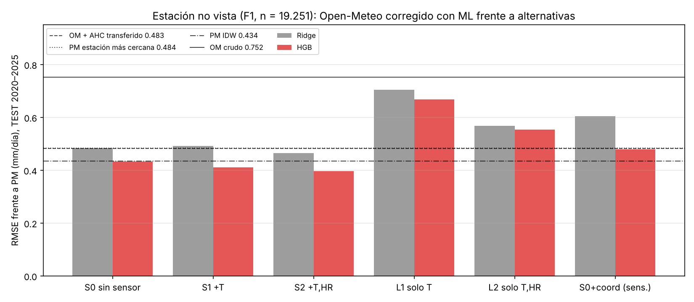
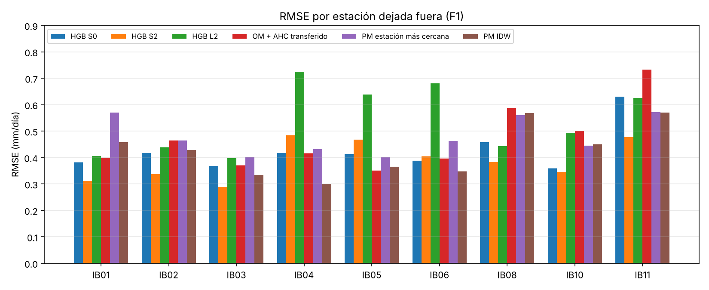
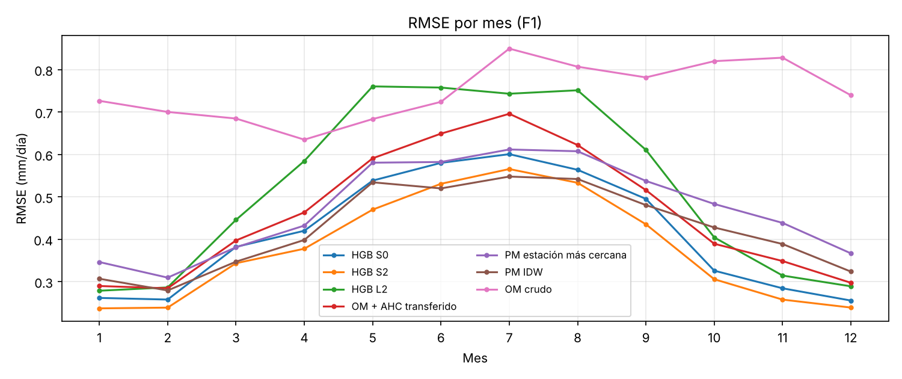

# Estudio 03: Open-Meteo corregido con ML, evaluado en estaciones no vistas (leave-one-station-out)

> **Numeración:** este estudio es el **03.2**. Se ejecuta después del **03.1** (`studies/03_1_loso_inputs_siar/`), que comprueba primero si los modelos de pocos inputs de SIAR funcionan en una estación no vista; el 03.1 es el que justifica (o no) este cambio de rumbo. La carpeta y `config/thresholds_v3.json` conservan su nombre porque los criterios ya están congelados.

Estado: **PLAN**. Protocolo y criterios en `config/thresholds_v3.json`; se congelan al fusionar el PR que los introduce, antes de ejecutar nada de este protocolo.

> **Ejecución (2026-11-26): EN PARTE.** Hecho: todos los comparadores, Ridge y HGB (primario) en las 12 particiones y los 6 escenarios, es decir, **todo lo que entra en H1–H4**, con veredicto más abajo («Resultados»). Pendiente: RF, ANN-S y ANN-M (216 celdas, secundarios; se ejecutan en Kaggle). El plan de abajo no se ha tocado: `thresholds_v3.json` quedó congelado al fusionar el PR #8.

## Por qué este estudio (cambio de rumbo)

Los estudios 01 y 02 dejan tres hechos:

1. Las ANN de V2 ganan a Open-Meteo + AHC **en su propia estación** (entrenadas y evaluadas en el mismo sitio). Es el caso de menos valor práctico: quien tiene una estación SIAR al lado ya tiene PM.
2. La familia que gana siempre (HG-Rs) necesita piranómetro. Quien tiene piranómetro suele tener también termohigrómetro y anemómetro, es decir, puede calcular PM. La familia realista con sensor barato (Valiantzas: T y HR) solo empata o gana por poco.
3. El error de Open-Meteo viene sobre todo del **viento** de la rejilla y de un **rango diurno de temperatura** demasiado estrecho; su radiación y su humedad son buenas (estudio 01, sustitución de inputs). Open-Meteo tiene la información, pero necesita corrección.

Una prueba exploratoria (`exploratorio/`, ver abajo) sugiere que un modelo **conjunto para Baleares** que corrige Open-Meteo con ML, entrenado con la PM de SIAR de otras estaciones, estima mejor en una estación no vista que copiar la estación más cercana o aplicar un coeficiente mensual. En cambio, los modelos que solo usan pocos inputs locales (T, o T y HR) se degradan mucho fuera de su estación.

Por eso se propone reorientar el producto de "ANN con pocos inputs locales" a **"datos de rejilla (Open-Meteo) corregidos para tu ubicación con la referencia SIAR"**, con sensor del usuario opcional. Este estudio lo comprueba con protocolo formal.

Pregunta principal: **en una ubicación sin estación SIAR, ¿un modelo conjunto que corrige Open-Meteo con ML se acerca a la PM de SIAR más que las alternativas sencillas?**

## Datos

| Bloque | Periodo | Fuente | Estado |
|---|---|---|---|
| Open-Meteo `archive` diario | 2004–2025 | `data/processed/openmeteo_archive.csv` | disponible |
| Referencia PM_FAO56_V1 | 2004–2025 | `data/reference/reference_*.csv` | disponible |
| Inputs de sensor SIAR | 2020–2025 | `data/reference/siar_inputs_2020_2025.csv` | disponible |
| Inputs de sensor SIAR | 2004–2019 | `data/reference/siar_inputs_2004_2019.csv` | **falta: paso previo** |
| Predicciones V2 (contexto) | 2020–2025 | `data/v2/` | disponible |

**Paso previo.** Exportar los inputs de sensor 2004–2019 con `tools/export_reference.py` desde `classical-baselines.csv` (SHA256 `f55e4ed1…af44`, en el servidor), con las mismas columnas que la exportación 2020–2025 (`--keep TempMax,TempMin,TempMedia,HumedadMax,HumedadMin,HumedadMedia,VelViento,Radiacion,quality_status --start 2004-01-01 --end 2019-12-31`). Si no se puede, alternativa: `datos_siar_baleares/IBxx_datos_completos.csv` de Capitulo-1, comprobando antes que en 2020–2025 coinciden con la exportación existente; si no coinciden, se para y se documenta.

## Diseño

**Separación espacial y temporal a la vez.** Se entrena solo con DESARROLLO (2004–2019) y solo con las estaciones de entrenamiento; se evalúa en TEST (2020–2025) en la estación dejada fuera, sobre la cohorte común de V2 (`common_core == 1`, n = 19.251), las mismas claves que el estudio 02. Así los números son comparables con V2 y con el estudio 02.

**Particiones (fijas, en `folds.json`):**
- **F1, leave-one-station-out (principal):** 9 particiones, una por estación.
- **F2, leave-one-island-out (prueba dura):** fuera Ibiza (IB01, IB11) y fuera Menorca (IB08). "Fuera Mallorca" deja solo 3 estaciones de entrenamiento: se ejecuta y se informa, pero no entra en los criterios.

**Escenarios de inputs** (lo que tendría un usuario en su parcela):

| Código | Inputs | Usuario tipo |
|---|---|---|
| S0 | Open-Meteo (ET0, Tmax, Tmin, radiación, viento medio y máximo, HR media/máx/mín) + seno y coseno del día del año + Ra + altitud | sin sensor |
| S1 | S0 + Tmax y Tmin del sensor | termómetro |
| S2 | S0 + Tmax, Tmin y HR media del sensor | termohigrómetro |
| L1 | solo sensor: Tmax, Tmin, Ra, día del año, altitud | modelo conjunto tipo HS-Ra |
| L2 | solo sensor: Tmax, Tmin, HR media, Ra, día del año, altitud | modelo conjunto tipo Valiantzas |

Latitud y longitud **no** entran en el escenario principal: con 9 estaciones funcionan casi como un identificador y el modelo memoriza. Se prueba solo como sensibilidad (S0+coord).

**Modelos (conjunto cerrado, declarado antes):**

| Modelo | Por qué |
|---|---|
| Ridge (lineal, inputs estandarizados) | Corrección estadística clásica (MOS); suelo de referencia |
| HistGradientBoosting | Primario (declarado de antemano) |
| Random Forest | Segundo árbol, distinto sesgo de modelo |
| ANN-S: MLP (32) | Red pequeña |
| ANN-M: MLP (64, 32) | Red media |

Hiperparámetros: rejilla pequeña declarada en `thresholds_v3.json`, elegida con validación cruzada interna agrupada por estación **dentro del entrenamiento** de cada partición. Nunca se mira TEST para elegir. Las ANN se entrenan con 5 semillas; la predicción es la media de las 5 y se informa además la dispersión entre semillas (incertidumbre de entrenamiento, que el estudio 02 no cubría). Predicciones negativas: se recortan a 0 y se informa cuántas.

No se añaden más arquitecturas después de ver resultados: comparar muchas variantes en el mismo TEST acaba eligiendo la que tuvo suerte.

**Comparadores:**

| Comparador | Qué representa |
|---|---|
| Open-Meteo crudo | lo que obtiene cualquiera gratis |
| OM + AHC mensual medio de las estaciones de entrenamiento | la corrección sencilla transferida |
| OM + AHC mensual de la estación de entrenamiento más cercana | idem, versión "vecino" |
| PM de la estación SIAR más cercana el mismo día | lo que hace la app SiAR |
| PM interpolada (IDW) de las estaciones de entrenamiento el mismo día | interpolación espacial sencilla |
| V2 local (HS-Ra, HG-Rs, Valiantzas: fórmula, AHC, ANN) y OM+AHC local del estudio 02 | **techo**: modelos de la propia estación; no son LOSO, solo contexto |

Los comparadores de estación más cercana e IDW usan observaciones del mismo día de otras estaciones: es legítimo como servicio operativo (esos datos existen en tiempo real), y se indica así.

## Métricas y criterios

Mismas definiciones que V2 y estudio 02: error = predicción − PM; n, MAE, RMSE, sesgo, R² = 1 − SSE/SST; DJF asigna diciembre al año siguiente. Desgloses por estación, mes, temporada y año. Diferencias pareadas ΔRMSE con IC 95 % por bootstrap de bloques estación-año (54 bloques, 2.000 réplicas, semilla fija).

Hipótesis (criterios en `config/thresholds_v3.json`):

- **H1 (principal):** HGB-S0 en F1 tiene menor RMSE que OM + AHC mensual medio transferido (ΔRMSE < 0 y extremo superior del IC < 0).
- **H2:** HGB-S0 en F1 tiene menor RMSE que la PM de la estación más cercana.
- **H3:** el sensor del usuario aporta: S2 mejora a S0 con el mismo modelo (IC < 0).
- **H4 (documenta el cambio de rumbo):** los modelos conjuntos solo de sensor (L1, L2) tienen mayor RMSE que S0.
- **Relevancia práctica:** una diferencia significativa menor de 0,05 mm/día se informa como "significativa pero pequeña".

Todo lo demás (otros modelos, F2, sensibilidad con coordenadas) se informa como secundario, sin veredicto.

## Salidas

`results/`: `folds.json`, `metrics_global.csv`, `metrics_by_station.csv`, `metrics_by_month.csv`, `paired_ci.csv`, `ann_seed_spread.csv`, `predictions_test.csv` (con columna de partición), `run_manifest.json` (SHA256 de entradas, versiones de librerías, semillas). `figures/` con RMSE por escenario y modelo, por estación y por mes. El README se completa con la lectura y las salvedades.

Dependencias: este estudio usa scikit-learn, pandas y numpy (`requirements.txt` de la carpeta). La librería `src/openmeteo_et0` sigue sin dependencias.

## Salvedades conocidas de antemano

- Referencia calculada (PM_FAO56_V1), no ET0 medida.
- Solo 9 estaciones, todas en zonas de regadío y cercanas entre sí: F1 es optimista; por eso F2.
- Se usa reanálisis (`archive`), que llega con unos 5 días de retraso. No dice nada del error con **previsión**: eso es el estudio 04.
- Open-Meteo: datos CC BY 4.0, API gratuita solo no comercial.

## Prueba exploratoria previa (no es resultado de este estudio)

`exploratorio/loso_rapido.py` y su salida `exploratorio/salida_2026-11-26.txt`: una sola ejecución con HGB, entrenamiento ≤ 2022 y prueba 2023–2025 (distinto de este protocolo), sin IC. Resultado: OM + ML sin sensor 0,41 mm/día de RMSE en estación no vista; OM + AHC mensual transferido 0,47; estación más cercana ≈ 0,47 (0,40–0,57 según el par); modelos conjuntos solo de sensor 0,57–0,69; Open-Meteo crudo 0,75. Se declara aquí porque el diseño de este estudio se escribió **después** de verla: es la razón del cambio de rumbo, no su demostración.

---

# Resultados (ejecución del 2026-11-26)

## Estado de la ejecución

| Bloque | Celdas | Estado | Dónde |
|---|---|---|---|
| Comparadores (OM crudo, OM + AHC transferido y vecino, PM más cercana, IDW) y techo local | — | hecho | entorno de trabajo de Claude |
| Ridge | 72 | hecho | entorno de trabajo de Claude (~1 s/celda) |
| HGB (primario) | 72 | hecho | entorno de trabajo de Claude (~1 min/celda) |
| RF | 72 | **pendiente** | Kaggle, sesión 1 |
| ANN-S y ANN-M (5 semillas) | 144 | **pendiente** | Kaggle, sesión 2 |

Celda = partición (9 F1 + 3 F2) × escenario (S0, S1, S2, L1, L2, S0_coord) × modelo. Cada celda se guarda en `results/cells/` (gzip, escritura atómica: se escribe en `.tmp` y se renombra) con sus predicciones, la rejilla de validación interna, el número de recortes a 0 y el entorno con el que se calculó. `report` une las que haya; las que faltan se listan en `results/run_manifest.json` (`missing_cells`).

```
python studies/03_loso_openmeteo_ml/run.py fit --models Ridge,HGB --workers 2   # hecho (~35 min con 2 núcleos)
python studies/03_loso_openmeteo_ml/run.py report                              # ~25 s
```

**Pendiente en Kaggle (aún no lanzado).** `kaggle_session.sh N` (CPU sin acelerador, internet activado, 4 núcleos, `--max-hours 8`), clonando esta rama:

```
!git clone --depth 1 -b estudio-03-2-ejecucion https://github.com/lependens/Capitulo-2 && cd Capitulo-2 && bash studies/03_loso_openmeteo_ml/kaggle_session.sh 1
```

| Sesión | Contenido | Celdas | Estimación |
|---|---|---|---|
| 1 | RF | 72 | ~22–25 h de núcleo → ~6–7 h con 4 núcleos |
| 2 | ANN-S + ANN-M | 144 | ~15–20 h de núcleo → ~4–5 h |
| 0 | lo pesado que falte (continuación) | — | — |

Base de la estimación (medido aquí, un núcleo): un RF de 300 árboles con todo el entrenamiento de S2 (42.957 filas × 16 inputs) tarda 90 s; una celda son 2 configuraciones × (8 ajustes de validación interna + 1 final), ≈ 20–25 min (L1/L2, con 6–7 inputs, menos). Una MLP tarda 3–7 s; una celda ANN son 85 ajustes (2 configuraciones × 8 folds × 5 semillas + 5 finales), ≈ 6–10 min. Si la sesión 1 llega al tope de 8 h sin acabar, se continúa con una versión nueva que monte la salida anterior como entrada (`kaggle_session.sh 0`): el guion recupera las celdas del 03.2 (`celdas_03_2_sesion_*.zip` o `.json.gz` sueltos, solo con nombres de celda del 03.2; ignora los del 03.1) y salta las hechas. Cada sesión deja `celdas_03_2_sesion_N.zip`, que se descomprime en `results/cells/` antes de volver a ejecutar `report`.

## Paso previo

`data/reference/siar_inputs_2004_2019.csv` (y su manifiesto) se trae **sin cambios** del commit 76d4aa8 del 03.1, que lo generó con `tools/export_inputs_from_raw.py` a partir de `datos_siar_baleares/IBxx_datos_completos.csv` de Capitulo-1 (la alternativa prevista arriba): en 2020–2025 coincide con la exportación existente con 0 discrepancias (19.272 filas × 8 columnas). Es el mismo objeto git que en la rama del 03.1, así que las dos ramas pueden fusionarse sin conflicto.

## Código compartido con el 03.1

`loso_common.py` (carga de datos, particiones, comparadores, métricas, bootstrap) y `loso_models.py` (rejillas y `select_and_fit`) son **copia literal** de `studies/03_1_loso_inputs_siar/` (commit 76d4aa8; idénticos también a la punta b8e2896 de `estudio-03-1-ejecucion`). No se ha modificado nada. `run.py` los carga con nombres de módulo propios para que los tests de los dos estudios puedan convivir en el mismo proceso. SHA256 en `run_manifest.json`.

## Controles

- **Particiones idénticas al 03.1:** `results/folds.json` es byte a byte igual al del 03.1.
- **Comparadores idénticos al 03.1** (mismo código, mismas filas): OM crudo 0,752; OM + AHC transferido 0,483; PM de la estación más cercana 0,484 (384 sustituciones por falta de dato, igual que en el 03.1); IDW 0,434.
- **L1 y L2 reproducen el 03.1:** L1 tiene los mismos inputs que la variante secundaria de HS-Ra del 03.1 y L2 que la de Valiantzas (en otro orden). HGB da 0,668 y 0,553, los mismos valores que allí.
- **Techo local:** V2 en la cohorte da los RMSE publicados (ANN E anual: 0,533 / 0,421 / 0,368) y OM + AHC local del estudio 02 da 0,534 (anual) y 0,427 (mensual).
- **Separación:** los tests comprueban, en cada partición, que ninguna estación de prueba entra en el entrenamiento, que se entrena solo con 2004–2019 y que las 9 particiones F1 cubren exactamente la cohorte (n = 19.251).

## Decisiones de implementación (no fijadas en los criterios)

1. **Inputs de Open-Meteo de S0** (`openmeteo_archive.csv`): `et0_om_mm`, `tmax_c`, `tmin_c`, `shortwave_sum_mj_m2`, `wind10_mean_ms`, `wind10_max_ms`, `rh_mean_pct`, `rh_max_pct`, `rh_min_pct`; más seno y coseno del día del año (periodo 365,25), Ra (FAO-56 con la latitud de la estación) y altitud de la estación (`stations.csv`). 13 inputs.
2. **Sensor:** S1 añade `TempMax` y `TempMin` de SIAR; S2 además `HumedadMedia`. L1 = `TempMax`, `TempMin` + calendario + Ra + altitud; L2 añade `HumedadMedia`. S0_coord = S0 + latitud y longitud.
3. **Objetivo:** PM_FAO56_V1 finita y ≥ 0 (regla de V2, como el 03.1).
4. **Filas de entrenamiento:** DESARROLLO, objetivo válido, estaciones de entrenamiento y todos los inputs del escenario finitos. Por eso el número de filas varía en 1 entre escenarios (42.958 en S0 frente a 42.957 en S2 en la partición IB01; `n_train` por celda en `model_selection.csv`).
5. **Validación interna:** dejar una estación fuera dentro de las de entrenamiento; métrica: media simple del RMSE de cada estación retenida; empate: la primera configuración de la rejilla (código del 03.1).
6. **Comparadores** (código del 03.1): AHC mensual = OLS por el origen; transferido = media simple de los coeficientes de las estaciones de entrenamiento; vecino = la de entrenamiento más cercana (haversine). PM de la estación más cercana con dato ese día (si falta, la siguiente). IDW con potencia 2.
7. **Techo local** (solo contexto, sin veredicto): V2 en las tres resoluciones y OM + AHC local del estudio 02 (`predictions_openmeteo_2020_2025.csv`).
8. **Bootstrap:** 54 bloques estación-año en F1 (en F2, los de esas estaciones), 2.000 réplicas, semilla 20261126, los mismos remuestreos para todas las comparaciones, IC por percentiles.

## Resultados F1 (estación no vista), TEST 2020–2025, n = 19.251

RMSE en mm/día. Tabla completa en `results/metrics_global.csv`.

| Método | RMSE | MAE | Sesgo | R² |
|---|---|---|---|---|
| Open-Meteo crudo | 0,752 | 0,626 | +0,542 | 0,806 |
| OM + AHC mensual transferido | 0,483 | 0,350 | −0,002 | 0,920 |
| OM + AHC mensual de la estación más cercana | 0,507 | 0,377 | +0,027 | 0,912 |
| PM de la estación más cercana, mismo día | 0,484 | 0,363 | +0,038 | 0,920 |
| PM IDW, mismo día | 0,434 | 0,324 | +0,047 | 0,935 |
| **HGB S0 (sin sensor)** | **0,433** | 0,315 | +0,042 | 0,936 |
| HGB S1 (+ termómetro) | 0,411 | 0,302 | +0,096 | 0,942 |
| **HGB S2 (+ termohigrómetro)** | **0,396** | 0,292 | +0,087 | 0,946 |
| HGB L1 (solo sensor T) | 0,668 | 0,496 | +0,219 | 0,847 |
| HGB L2 (solo sensor T y HR) | 0,553 | 0,399 | +0,157 | 0,895 |
| HGB S0 + coordenadas (sensibilidad) | 0,479 | 0,355 | +0,046 | 0,921 |
| Ridge S0 / S1 / S2 / L1 / L2 / S0+coord | 0,484 / 0,491 / 0,465 / 0,704 / 0,568 / 0,604 | | | |
| *Techo local (no LOSO): OM + AHC mensual local (estudio 02)* | *0,427* | | | |
| *Techo local: V2 ANN E anual HS-Ra / Valiantzas / HG-Rs* | *0,533 / 0,421 / 0,368* | | | |



## Hipótesis (ΔRMSE = A − B, F1, IC 95 %)

| Hipótesis | A | B | RMSE A | RMSE B | ΔRMSE [IC 95 %] | Criterio (`thresholds_v3.json`) | Veredicto |
|---|---|---|---|---|---|---|---|
| **H1 (principal)** | HGB-S0 | OM + AHC mensual transferido | 0,433 | 0,483 | −0,050 [−0,069; −0,029] | Δ < 0 y extremo superior < 0 | **Se cumple** (significativa pero pequeña: \|Δ\| = 0,0498 < 0,05) |
| **H2** | HGB-S0 | PM estación más cercana | 0,433 | 0,484 | −0,051 [−0,084; −0,018] | Δ < 0 y extremo superior < 0 | **Se cumple** (\|Δ\| = 0,051, justo por encima del umbral práctico) |
| **H3** | HGB-S2 | HGB-S0 | 0,396 | 0,433 | −0,037 [−0,062; −0,012] | extremo superior < 0 | **Se cumple** (significativa pero pequeña) |
| **H4** | HGB-L1 | HGB-S0 | 0,668 | 0,433 | +0,235 [+0,199; +0,274] | extremo inferior > 0 | sí |
|  | HGB-L2 | HGB-S0 | 0,553 | 0,433 | +0,120 [+0,079; +0,162] | extremo inferior > 0 | sí → **H4 se cumple** |

## Regla de decisión (aplicación literal)

`thresholds_v3.json` no define una regla de decisión aparte de las hipótesis: la regla es el criterio de cada hipótesis (solo F1, solo HGB) más el umbral práctico de 0,05 mm/día («una diferencia significativa menor de 0,05 se informa como significativa pero pequeña»). Todo lo demás es secundario y sin veredicto. Aplicada tal cual (`results/decision.json`):

- **H1 se cumple:** en una estación no vista, Open-Meteo corregido con HGB y sin sensor tiene menor error que Open-Meteo con el coeficiente mensual transferido. La mejora es de 0,050 mm/día (−10 %), **significativa pero pequeña**: queda 0,0002 por debajo del umbral.
- **H2 se cumple:** también gana a copiar la PM de la estación SIAR más cercana (−0,051, −11 %). Supera el umbral práctico por muy poco.
- **H3 se cumple:** un termohigrómetro del usuario mejora el modelo (−0,037, −9 %), **significativa pero pequeña**.
- **H4 se cumple:** los modelos conjuntos solo de sensor son claramente peores que S0 (+0,24 con termómetro y +0,12 con termohigrómetro). Documenta el cambio de rumbo: para una estación no vista, Open-Meteo corregido supera a los modelos de pocos inputs locales.

**Lectura:** el cambio de rumbo se sostiene, con ganancias modestas. Hay una salvedad importante que no entra en las hipótesis: **la IDW del mismo día empata con HGB-S0** (−0,002 [−0,030; +0,026]); solo S2 la supera, y por poco (−0,039 [−0,074; −0,003]). Es decir, sin sensor el modelo iguala, pero no mejora, la interpolación de las estaciones SIAR del mismo día. Su ventaja práctica es que no necesita esas estaciones (vale fuera de su red y con previsión, estudio 04). Además, HGB-S0 en estación no vista empata con OM + AHC mensual **local** del estudio 02 (+0,006 [−0,009; +0,020]), que sí usa datos de la propia estación.

Cifras ajustadas: H1 queda a 0,0002 del umbral práctico y H2 a 0,001. Se informan tal cual salen de la regla.

## Secundario (sin veredicto)

- **Por estación** (F1, `metrics_by_station.csv`, figura 2): HGB-S0 va de 0,36 (IB10) a 0,63 (IB11). Tiene menor RMSE que OM + AHC transferido en 7 de 9 estaciones; prácticamente igual en IB04 (0,417 frente a 0,416) y peor en IB05 (0,412 frente a 0,351). En IB04, IB05 e IB06 (Mallorca central) la IDW es la mejor opción (las estaciones vecinas están cerca). El sensor (S2) mejora en 6 de 9 estaciones, pero empeora en IB04, IB05 e IB06.
- **Por temporada** (`metrics_by_month.csv`): HGB-S0 / S2 / OM + AHC / estación más cercana / IDW: invierno 0,26 / 0,24 / 0,29 / 0,34 / 0,31; verano 0,58 / 0,54 / 0,66 / 0,60 / 0,54.
- **F2 (fuera de isla), HGB-S0 frente a OM + AHC / estación más cercana / IDW:** fuera Ibiza (12 bloques): 0,509 frente a 0,587 / 0,745 / 0,612, gana a los tres (IC < 0). Fuera Menorca (6 bloques): 0,458 frente a 0,587 / 0,561 / 0,568, gana a los tres. Fuera Mallorca (informativo, 3 estaciones de entrenamiento): 0,477, peor que OM + AHC (0,428). Al alejarse de la red SIAR, el modelo mantiene el error y los comparadores de vecindad empeoran.
- **Coordenadas (S0_coord):** empeoran (+0,046 [+0,025; +0,067]), como se temía en el diseño (memorizan la estación).
- **Ridge:** peor que HGB en todos los escenarios (S0: +0,051 [+0,032; +0,070]); en S0 empata con OM + AHC transferido. 489 predicciones de Ridge recortadas a 0 en total; HGB, 0.
- **Comparadores entre sí:** IDW gana a la estación más cercana (−0,049 [−0,069; −0,032]); OM + AHC transferido empata con ella (−0,001 [−0,038; +0,035]); el AHC del vecino es peor que el transferido (+0,024 [+0,012; +0,037]).
- **Hiperparámetros elegidos** (`model_selection.csv`): en S0, HGB elige tasa 0,1 y 31 hojas en 8 de 9 particiones.





## Pendiente

RF, ANN-S y ANN-M (216 celdas, ≈ 40–45 h de un núcleo), según «Estado de la ejecución». No intervienen en ninguna hipótesis, así que **los veredictos de H1–H4 no cambian al completarlas**. Al terminar se completan aquí la fila de cada modelo, `ann_seed_spread.csv` (dispersión entre semillas) y las figuras.

## Salvedades de la ejecución

- Esta rama parte de `main` (con el PR #8 fusionado, criterios congelados). El PR #9 (criterios del 03.1) no estaba fusionado; de la rama del 03.1 solo se traen, sin cambios, los inputs 2004–2019 y el código común.
- Las celdas de Ridge y HGB se calcularon en el entorno de trabajo de Claude con las versiones fijadas en `requirements.txt` (las mismas que exige `check_env.py` en Kaggle); el entorno de cada celda queda guardado en ella.
- H1 y H2 quedan muy cerca del umbral práctico; con otro corte temporal o más estaciones podrían caer a uno u otro lado de 0,05.
